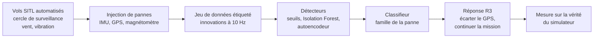

# Détection de pannes capteurs et récupération sur drone — ArduPilot SITL

Projet personnel, en cours : détecter automatiquement les pannes de capteurs d'un drone
multirotor à partir de ce que voit son filtre de navigation, puis réagir sans abandonner la
mission. Tout est fait en simulation (ArduPilot SITL, ArduCopter), sur 376 vols, tous
automatisés sauf les quatre premiers, qui ont servi à se familiariser avec l'interface.

Titre visé : *Machine Learning Based IMU Fault Detection and Recovery for Autonomous UAVs*.

## Le problème

Un drone estime sa position, sa vitesse et son attitude avec un filtre de Kalman étendu (l'EKF3
d'ArduPilot). La centrale inertielle (IMU : accéléromètres et gyroscopes) sert à **prédire** le
mouvement ; le GPS, le baromètre et le magnétomètre servent à **corriger** cette prédiction.
Quand un capteur tombe en panne, l'estimation devient fausse, et le drone peut aller ailleurs
que là où il croit être.

Certaines pannes s'annoncent d'elles-mêmes (un GPS qui perd son fix). D'autres sont
**silencieuses** : un biais d'accéléromètre, une dérive lente, un GPS leurré qui donne une
position fausse avec un fix parfait. Ce sont celles-là que le projet cherche à détecter.

**Le signal utilisé : les innovations de l'EKF.** À chaque mesure, l'EKF compare ce que le
capteur mesure à ce qu'il avait prédit. L'écart, rapporté à l'écart attendu, s'appelle une
innovation (enregistrée par ArduPilot dans le message `XKF4`) : **SV** pour la vitesse GPS,
**SP** pour la position GPS, **SH** pour la hauteur, **SM** pour le magnétomètre. Une valeur de
1 est le seuil au-delà duquel l'EKF rejette la mesure. En vol normal, elles restent faibles ;
une panne les fait monter, souvent bien avant que l'EKF ne rejette quoi que ce soit.

## La démarche

1. **Un banc de vols automatique** (`scripts/lancer_vol.sh`, `scripts/vol_auto.py`) : le drone
   décolle, tourne sur un cercle de 30 m à 15 m de haut (une mission de surveillance), reçoit
   une panne pendant 60 s à un instant choisi, puis rentre. Vent réglable (0 à 9 m/s, avec
   turbulence), vibration des moteurs, capteur de flux optique.
2. **Les pannes** sont injectées par les paramètres du simulateur : biais, dérive lente et
   blocage d'accéléromètre, biais et bruit de gyroscope, décalage du magnétomètre, coupure,
   brouillage et leurre du GPS (en échelon ou en rampe).
3. **Un jeu de données étiqueté** est extrait de chaque log (`construire_jeu_donnees.py`) :
   innovations, statut GPS, et pour chaque instant « nominal », « panne » ou « après panne ».
4. **Des détecteurs de plus en plus élaborés**, tous entraînés ou calibrés **sur des vols sans
   panne** seulement : un seuil fixe, un seuil qui s'adapte au niveau du moment, un Isolation
   Forest, puis un autoencodeur. Ils tournent aussi en vol, sur le flux MAVLink. Un classifieur
   (forêt aléatoire, `classifieur.py`) dit ensuite, 3 s après l'alarme, de quelle famille est la
   panne : accéléromètre, gyroscope, GPS ou magnétomètre.
5. **Une réponse aux pannes GPS, R3** (`scripts/recuperation.py`) : plutôt qu'atterrir (la
   réaction par défaut d'ArduPilot), écarter le GPS fautif, continuer le cercle à l'estime ou au
   flux optique, puis reprendre le GPS quand il redevient cohérent. Contexte visé : un
   environnement où le brouillage est normal et où abandonner la mission n'a pas de sens.
6. **Une mesure honnête** : l'erreur de navigation est calculée contre la **position vraie** du
   simulateur, que le drone ne connaît pas.

Règles suivies pour chaque résultat : les réglages sont figés **avant** de regarder les vols de
test, ces vols n'ont servi à aucun réglage, et le test n'est exécuté qu'une fois.

## Où en est le projet

| Étape | État | Résultat principal |
|---|---|---|
| Banc de vols automatique | fait | 376 vols, protocole identique depuis le vol 5 |
| Détection, IMU simulée idéale | fait | test sur 60 vols neufs : jusqu'à 41 pannes sur 42, aucune fausse alarme |
| Détection en vol (temps réel) | fait | mêmes alarmes en vol qu'après coup, 0 écart sur 60 vols rejoués |
| Récupération des pannes GPS (R3) | fait, 3 versions | GPS sain repris 6 fois sur 7 ; échoue encore sur un leurre lent |
| Réalisme : bruit et vibration de l'IMU | fait | la vibration dégrade fortement détection et navigation à l'estime |
| Flux optique sous vibration | fait | R3 reprend le GPS sain 9 fois sur 9 |
| Autoencodeur, détecteurs recalibrés sous vibration | fait | 21 pannes sur 32 sans fausse alarme ; petites pannes d'IMU manquées par tous |
| Comprendre pourquoi les petites pannes d'IMU deviennent invisibles | fait | la vibration (gyroscopes comme accéléromètres) noie la panne dans le bruit ; l'EKF ne s'en protège pas |
| Classification de la famille de panne | fait | test sur 36 vols neufs : 18 sur 18 sans vibration, 14 sur 16 sous vibration |
| Récupération des pannes d'IMU | **à faire** | |
| R3 guidé par le type de panne plutôt que par une règle | à faire | |

## Résultats principaux

### 1. Avec une IMU idéale, les pannes silencieuses se détectent

Test final sur 60 vols neufs (18 nominaux, 42 pannes, dont quatre types jamais vus pendant les
réglages ; vent de 0 à 9 m/s) :

| | Seuil fixe | Seuil adaptatif | Isolation Forest | Isolation Forest + seuil adaptatif |
|---|---|---|---|---|
| Pannes détectées | 32 / 42 | 31 / 42 | 41 / 42 | **41 / 42** |
| Fausses alarmes (8 217 s de vol normal) | 0 | 0 | 0 | **0** |

La combinaison réagit en 0,5 à 0,7 s aux pannes franches (magnétomètre, accéléromètre bloqué)
et détecte toutes les dérives lentes, que le seuil adaptatif seul manque parce qu'il suit leur
montée (figure 1). Les biais d'accéléromètre de 0,2 à 1,0 m/s² sont vus en 0,7 à 2,6 s.

*Figure 1 — Vol 104 : dérive d'accéléromètre de 0 à 0,5 m/s² en 60 s, sans vent. De haut en
bas : les innovations SV, SP et SM avec le seuil fixe (tirets bleus) et le seuil adaptatif
(orange), le score d'anomalie de l'Isolation Forest et son seuil, puis les périodes d'alarme de
chaque détecteur. Zone rose : panne. Le seuil adaptatif monte avec la dérive et ne la voit
jamais ; l'Isolation Forest la détecte en 17,3 s, le seuil fixe seulement en 54,0 s.*

### 2. Ne pas atterrir : écarter le GPS et continuer la mission

Quatre réponses à une panne GPS ont été comparées sur les mêmes vols :

| Réponse | Ce que fait le drone |
|---|---|
| **R0 « rien »** | aucune réaction : le failsafe de l'EKF est désactivé (`FS_EKF_ACTION 0`). Sert de référence. |
| **R1 « natif »** | la réaction par défaut d'ArduPilot : quand l'EKF signale que sa position n'est plus fiable (failsafe EKF), le drone atterrit sur place. |
| **R2 « natif + traînée »** | la même, avec en plus le modèle de traînée de l'EKF. Ce modèle relie l'inclinaison du drone au vent : l'EKF estime le vent tant que le GPS est là, puis peut continuer à naviguer à l'estime (avec la seule centrale inertielle) quand il disparaît ; ArduPilot rentre alors au point de départ. Le failsafe EKF reste actif : s'il se déclenche, le drone atterrit, comme avec R1. |
| **R3** (ce projet) | écarter le GPS dès que le fix est perdu, ou dès que le détecteur voit l'innovation de position (SP) monter seule alors que le fix est bon (signature d'un leurre) ; continuer le cercle à l'estime ; reprendre le GPS quand sa position reste cohérente avec l'estimée (pendant 5 s dans la première version, 30 s depuis la troisième) ; retour au départ en dernier recours après 2 minutes sans GPS fiable. |

Face à un **brouillage**, sans réponse (R0), l'EKF accepte des positions GPS fausses et l'erreur
de navigation dépasse 2,6 km. ArduPilot (R1 et R2) atterrit sous le vent, hors de la zone
surveillée. R3 écarte le GPS en 0,6 s et garde son cercle, avec une erreur de 9 m (figure 2). Face à un **leurre en échelon**,
R3 écarte le GPS avant que l'EKF ne l'accepte. Sur 30 vols de validation, R3 reprend le GPS sain
6 fois sur 7. Deux défauts restent connus : un leurre en rampe lent peut être repris, et une
dérive d'accéléromètre a été prise une fois pour un leurre.

*Figure 2 — Vols 133 à 136 : brouillage GPS de 60 s sous un vent de 6 m/s venant du nord, une
ligne par réponse (R0 à R3, dans sa première version). Colonnes : trajectoire vue de dessus, positions nord et est au cours
du temps, puis erreur de navigation (bleu) et distance vraie au centre du cercle (noir), en
échelle logarithmique au-delà de 50 m. Trait noir : position vraie ; tirets bleus : position
estimée par l'EKF ; zone rose : panne ; trait rouge : atterrissage déclenché par ArduPilot ;
tirets et pointillés verts : GPS écarté puis repris par R3 ; cercle pointillé : zone surveillée
de 60 m.*

### 3. La vibration des moteurs change tout

Ces premiers résultats ont été obtenus avec une IMU simulée sans bruit ni vibration. Avec la
vibration que les tests d'ArduPilot reprennent d'un quadricoptère de 180 mm (6 à 12 m/s², un
niveau jugé acceptable), les innovations d'un vol normal sont multipliées par 4 à 10 (figure 3). Les
détecteurs calibrés sans vibration font alors jusqu'à 155 fausses alarmes, l'erreur de la
navigation à l'estime atteint 107 à 186 m pendant une coupure GPS de 60 s (au lieu de 8 à 47 m),
et R3 ne reprend le GPS sain qu'une fois sur six.

*Figure 3 — Innovations SV, SP et SM pendant un vol normal sous un vent de 6 m/s venant de 20° :
vol 233 avec vibration (rouge), vol 242 sans vibration (bleu). Tirets : seuils fixes calibrés
sans vibration, franchis à répétition dès que le drone vibre.*

**Un capteur de flux optique** (caméra vers le sol et télémètre, simulés), fusionné en
permanence, borne cette dérive : sous la même vibration, R3 reprend le GPS sain 9 fois sur 9 et
l'erreur de position reste sous 16 m pendant la panne (figure 4).

*Figure 4 — Erreur de position vraie pendant que R3 a écarté le GPS (leurres et brouillages,
vibration, vent de 6 m/s) : sans flux optique (rouge, vols 248 à 253) et avec (bleu, vols 259 à
267). À droite, zoom sur 0 à 25 m.*

### 4. Sous vibration, les petites pannes d'IMU échappent à tous les détecteurs

Les détecteurs ont été recalibrés sur des vols normaux avec vibration et flux optique, un
autoencodeur a été ajouté, puis tous ont été testés une fois sur 32 pannes neuves :

| | Seuil fixe | Seuil adaptatif | Isolation Forest | IF + adaptatif | Autoencodeur |
|---|---|---|---|---|---|
| Pannes détectées | 18 / 32 | 23 / 32 | 10 / 32 | 23 / 32 | **21 / 32** |
| Fausses alarmes (4 908 s) | 0 | 13 | 0 | 13 | **0** |

L'autoencodeur, un réseau de neurones qui apprend à reconstruire le vol normal, est le meilleur
compromis : aucune fausse alarme, et toutes les pannes franches (magnétomètre, leurres GPS,
accéléromètre bloqué) en moins de 2 s. Mais **aucun détecteur ne voit les biais
d'accéléromètre de 0,3 et 0,5 m/s², les dérives, ni le biais de gyroscope de 0,01 rad/s**, alors
que ces pannes étaient presque toutes détectées sans vibration. Le seuil de l'autoencodeur dépend
aussi du tirage initial du réseau (de 0,68 à 1,59 sur 5 graines).

**Pourquoi ces pannes deviennent invisibles** (vols 329 à 340, même biais de 0,3 m/s² et même
vent, en ne faisant vibrer que les gyroscopes ou que les accéléromètres) : chacune des deux
vibrations suffit seule à ajouter à l'innovation de vitesse un bruit plus fort que l'effet de la
panne. Celle des gyroscopes passe surtout par une erreur d'attitude (0,55 à 0,62° contre 0,12 à
0,15° sans vibration), celle des accéléromètres entre directement dans la vitesse prédite. L'EKF
ne s'en protège pas : son mécanisme anti-vibration ne se déclenche pas, son incertitude reste la
même et il s'attribue environ 0,45° d'erreur d'attitude quelle que soit l'erreur vraie. Le flux
optique n'y est pour rien. Deux vols par configuration ; détail dans
[`docs/demarche.md`](docs/demarche.md).

### 5. La famille de la panne se reconnaît 3 s après l'alarme

Un classifieur (forêt aléatoire) reçoit les innovations des 3 s qui suivent l'alarme, leur niveau
des 30 s précédentes et l'état du GPS, et donne la famille de la panne : accéléromètre,
gyroscope, GPS ou magnétomètre. Il est comparé à des règles écrites à la main (GPS si le fix
tombe, magnétomètre si SM domine, accéléromètre sinon). Testé une fois sur 36 vols neufs, sous
des vents jamais vus à l'apprentissage :

| | Pannes détectées | Règles | Forêt aléatoire |
|---|---|---|---|
| Sans vibration (vols 341 à 358) | 18 / 18 | 12 / 18 | **18 / 18** |
| Vibration + flux optique (vols 359 à 376) | 16 / 18 | 7 / 16 | **14 / 16** |

La forêt distingue le gyroscope de l'accéléromètre, ce que les règles ne savent pas faire, et
reconnaît les leurres GPS, qui laissent le fix intact. Ses deux erreurs sont les deux biais
d'accéléromètre de 1,0 m/s² sous vibration, pris pour le gyroscope : à l'apprentissage sous
vibration, cette famille ne comptait presque que des accéléromètres bloqués. Deux vols par type
de panne ; seule la famille est donnée, pas le type ni l'amplitude.

## Limites

- Tout est simulé. Le modèle de vibration du simulateur (une oscillation par moteur) et le flux
  optique (sol plat et texturé partout) n'ont pas été comparés à de vrais vols.
- Peu de vols par configuration (un à quatre) : les chiffres donnent un ordre de grandeur, pas
  une statistique.
- Les pannes touchent les trois IMU à la fois (sauf l'accéléromètre bloqué) : c'est le cas le plus
  difficile, mais la comparaison entre capteurs redondants n'est pas exploitée.
- Les leurres GPS sont simplifiés : la position est décalée, pas la vitesse.
- Une seule mission (le cercle), un seul type de drone (le quadricoptère du simulateur).

## Prochaines étapes

1. **Récupérer une panne d'IMU** : injecter la panne sur une seule des trois IMU, la détecter
   et l'écarter, et comparer à ce que fait ArduPilot seul (bascule sur l'autre cœur EKF).
2. **Guider R3 par la famille de la panne** plutôt que par une règle fixe : distinguer un leurre d'une
   dérive d'accéléromètre avant d'écarter le GPS, et juger le GPS pendant l'exclusion autrement
   qu'en le comparant à une estimée qui dérive.
3. Ensuite : détecter les petites pannes d'IMU sous vibration en intégrant leur effet dans le
   temps ; fixer le seuil de l'autoencodeur sur davantage de vols ; pannes sur un seul capteur
   (comparaison entre capteurs redondants) ; vérifier le réalisme de la dérive à l'estime sous
   vibration ; comprendre l'exclusion à tort du vol 267 ; traiter la phase qui suit le retrait
   d'une panne.

## Pour aller plus loin

- [`docs/demarche.md`](docs/demarche.md) : la démarche complète, étape par étape et dans l'ordre
  chronologique, avec chaque protocole, chaque chiffre, les erreurs rencontrées et leurs
  corrections.
- [`docs/vols.md`](docs/vols.md) : la liste des 376 vols et leur numérotation.
- [`docs/utilisation.md`](docs/utilisation.md) : le rôle de chaque script, comment relancer un vol
  (automatique ou manuel) et analyser un log.

## Organisation du dépôt

- `scripts/` : banc de vol (`lancer_vol.sh`, `vol_auto.py`), jeu de données
  (`construire_jeu_donnees.py`), détecteurs (`detecteur_seuil.py`, `detecteur_adaptatif.py`,
  `detecteur_ml.py`, `detecteur_ae.py`, `detecteur_en_ligne.py`), classifieur (`classifieur.py`),
  comparaisons (`comparer_detecteurs.py`), récupération (`recuperation.py`, `erreur_navigation.py`) et figures.
- `docs/` : documentation détaillée, figures, rôle des vols de la dernière campagne.
- `data/` (non versionné) : jeux de données régénérables et journaux de vol. Les logs `.BIN`
  restent dans le dossier d'ArduPilot.

ArduCopter V4.8.0-dev, commit `14c871f` (2026-09-09), cloné hors de ce dépôt. Python avec
pymavlink, pandas, matplotlib et scikit-learn (`requirements.txt`).
