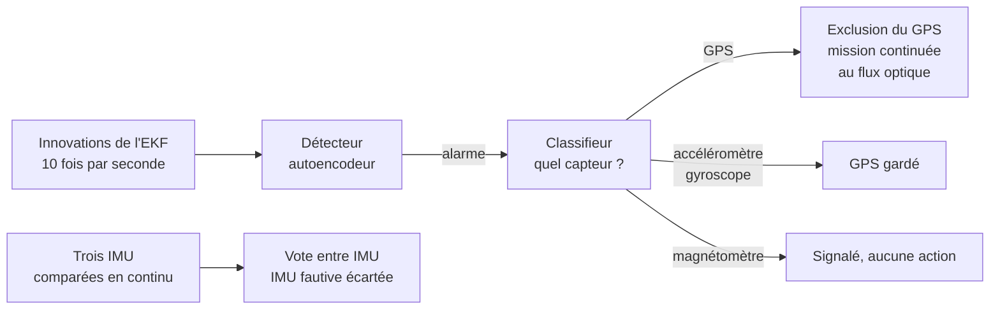
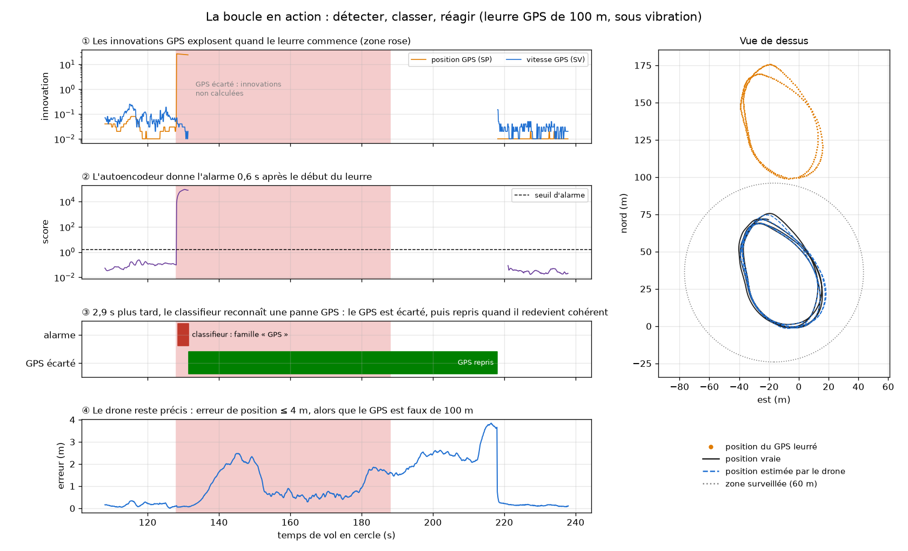
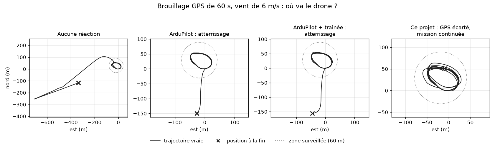
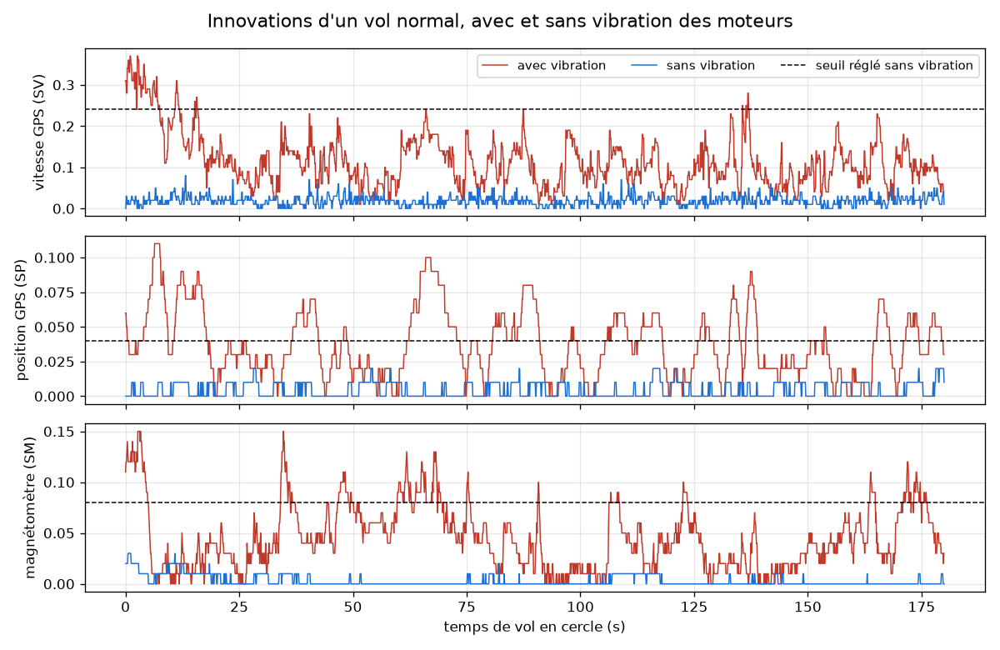

# Détection de pannes capteurs et récupération sur drone — ArduPilot SITL

Projet personnel : un drone qui **détecte seul la panne d'un de ses capteurs, reconnaît de quel
capteur il s'agit et réagit sans abandonner sa mission**. Tout est fait en simulation, avec le
simulateur officiel d'ArduPilot (SITL, ArduCopter), sur 531 vols automatisés.

Titre visé : *Machine Learning Based IMU Fault Detection and Recovery for Autonomous UAVs*.

**Démonstration (1 min 40)** : un leurre GPS de 100 m sous vibration des moteurs, détecté, classé
et écarté en vol, puis le [tableau de bord](https://antcro29.github.io/uav-imu-fault-detection/dashboard/)
des 48 vols de test. Le vol montré est un vol de démonstration, hors campagne de test.

https://github.com/user-attachments/assets/8f6523cb-7493-45d3-8cec-c01272f9aafb

**En bref**

- **Ce qui marche :** sous vibration des moteurs, la chaîne complète (détection, puis
  identification du capteur, puis réaction) a fait la bonne réaction sur les 24 configurations de
  panne testées, sans aucune fausse alarme, en restant dans sa zone de mission.
- **Ce qui bloque :** sous vibration, les petites pannes d'accéléromètre ou de gyroscope qui
  touchent toutes les IMU à la fois ne sont vues par aucun détecteur ; et la navigation sans GPS
  ne tient que grâce à un capteur de flux optique simulé dans des conditions idéales.
- **Périmètre :** simulation seulement, une mission (un cercle de surveillance), un à trois vols
  par configuration : les chiffres sont des ordres de grandeur, pas des statistiques.

## Le problème

Un drone estime sa position, sa vitesse et son orientation avec un filtre de Kalman étendu
(**EKF**, ici l'EKF3 d'ArduPilot). La centrale inertielle (**IMU** : accéléromètres et gyroscopes)
sert à **prédire** le mouvement ; le GPS, le baromètre et le magnétomètre servent à **corriger**
cette prédiction. Quand un capteur tombe en panne, l'estimation devient fausse et le drone peut
aller ailleurs que là où il croit être.

Certaines pannes s'annoncent d'elles-mêmes : un GPS **brouillé** perd son « fix », c'est-à-dire sa
position valide. D'autres sont **silencieuses** : un biais d'accéléromètre, une dérive lente, un
GPS **leurré** qui donne une position fausse avec un fix parfait. Ce sont celles-là que le projet
cherche à détecter.

**Le signal utilisé : les innovations de l'EKF.** À chaque mesure, l'EKF compare ce que mesure le
capteur à ce qu'il avait prédit. Cet écart, rapporté à l'écart attendu, s'appelle une
**innovation** : SV pour la vitesse GPS, SP pour la position GPS, SH pour la hauteur, SM pour le
magnétomètre. À 1, l'EKF rejette la mesure. En vol normal, les innovations restent faibles ; une
panne les fait monter, souvent bien avant que l'EKF ne rejette quoi que ce soit.

## Ce que fait le système

1. **Le détecteur** : un **autoencodeur**, réseau de neurones entraîné uniquement sur des vols sans
   panne à reproduire les innovations des 3 dernières secondes. Quand il n'y arrive plus, le vol
   ne ressemble plus à un vol normal : c'est l'alarme. Deux autres sources peuvent aussi la
   donner : la perte du fix GPS, et un **Isolation Forest** (méthode d'apprentissage qui isole les
   points inhabituels), gardé en parallèle mais qui n'a déclenché aucune alarme propre au test.
2. **Le classifieur** : une forêt aléatoire (un ensemble d'arbres de décision) qui, 3 s après
   l'alarme, dit de quelle famille est la panne : GPS, accéléromètre, gyroscope ou magnétomètre.
3. **La réaction à une panne GPS, l'exclusion du GPS** : au lieu d'atterrir, réaction par défaut
   d'ArduPilot, le drone **écarte le GPS** et continue son cercle avec ce qui lui reste (centrale
   inertielle et **flux optique** : une caméra tournée vers le sol mesure son défilement, donc la
   vitesse du drone, avec un télémètre pour la hauteur). Il reprend le GPS quand la position GPS reste cohérente avec sa
   propre estimation pendant 30 s. **Dernier recours** : si le GPS n'est toujours pas jugé fiable
   2 minutes après avoir été écarté, le drone rentre à son point de départ (ou atterrit sur place
   si ArduPilot refuse ce retour faute de position).
4. **La réaction à une panne d'IMU, le vote entre IMU** : le drone simulé porte trois IMU. Un vote
   compare en continu leurs mesures, désigne celle qui s'écarte des deux autres, puis oblige l'EKF
   à utiliser celle de ses deux estimations (ses deux « cœurs », chacun alimenté par une IMU) qui
   ne dépend pas de l'IMU fautive. ArduPilot ne le fait pas de lui-même : sur les vols d'essai,
   il n'a jamais basculé et l'erreur d'orientation est montée jusqu'à 6° (au test, il a basculé
   une fois, 9,8 s après le début de la panne).

La **boucle complète** enchaîne ces étapes seule, en vol, sans savoir quelle panne a été
injectée ; elle prend une seule décision par vol.

## Résultat final : la boucle complète sous vibration

Test unique sur 48 vols neufs, jamais utilisés pour un réglage : trois IMU, vibration des moteurs,
flux optique, vent de 6 m/s venant de trois directions jamais vues. Chaque panne, injectée pendant
60 s, est volée deux fois : avec la boucle, puis avec la réaction que j'aurais choisie à la
main en connaissant la panne.

| Panne injectée | Ce que fait la boucle, sans connaître la panne | Résultat |
|---|---|---|
| Biais d'accéléromètre sur une IMU | vote : IMU fautive désignée en 1,1 s | erreur d'orientation ≤ 1,3° |
| Biais de gyroscope sur une IMU | vote : IMU fautive désignée en 1,5 à 1,6 s | erreur d'orientation ≤ 4,1° |
| Dérive lente commune aux trois IMU | rien : panne non détectée (voir « Ce qui bloque ») | GPS gardé, pas d'exclusion à tort |
| GPS leurré de 100 m, d'un coup ou progressivement | GPS écarté 3,4 à 3,6 s après le début, repris 90 s après | erreur de position ≤ 19 m |
| GPS brouillé | GPS écarté à la perte du fix (0,7 s), repris 90 s après | erreur de position ≤ 13 m |
| Magnétomètre décalé | panne reconnue, signalée, aucune action | — |
| Aucune panne | rien | aucune fausse alarme |

- **Bonne réaction 24 fois sur 24**, la même que la réaction choisie à la main ;
- **aucune fausse alarme** sur 3 142 s de vol normal ;
- **drone 100 % du temps dans sa zone de mission** (60 m autour du centre du cercle), de
  l'injection à 150 s après ;
- dernier recours jamais déclenché.

Sur les leurres, la boucle écarte le GPS environ 3 s plus tard que si la panne était connue :
c'est le temps que prend le classifieur. La même boucle, testée sans vibration sur 48 autres
vols, avait aussi fait la bonne réaction 24 fois sur 24.

*Figure 1 — La boucle complète face à un leurre GPS de 100 m, sous vibration, telle qu'elle l'a
vécue en vol (valeurs enregistrées par la boucle pendant le vol). ① Les innovations GPS (échelle
logarithmique) bondissent quand le leurre commence (zone rose). ② Le score de l'autoencodeur
dépasse son seuil : alarme. ③ Le classifieur reconnaît une panne GPS et le GPS est écarté ; il est
repris 30 s après la fin du leurre, une fois redevenu cohérent avec la position estimée. Pendant
l'exclusion, les innovations GPS ne sont plus calculées (trou dans ① et ②). ④ L'erreur de
position du drone reste sous 4 m. À droite, vue de dessus : le GPS leurré (orange) place le drone
100 m au nord ; la position vraie (noir) et l'estimée (tirets bleus) restent sur le cercle.*

Pourquoi ne pas simplement atterrir, comme le fait ArduPilot ? Parce que sous le vent, sans
position fiable, le drone atterrit loin de sa zone, voire n'importe où (figure 2).

*Figure 2 — Brouillage GPS de 60 s sous un vent de 6 m/s, sans vibration : trajectoire vraie
selon la réaction. Sans réaction, l'EKF suit le GPS brouillé et le drone part à plusieurs
centaines de mètres. ArduPilot (avec ou sans modèle de traînée, qui lui permet d'estimer le vent)
atterrit en dérivant sous le vent, hors de la zone surveillée. En écartant le GPS, le drone garde
son cercle.*

## Ce qui bloque encore

1. **Les petites pannes d'IMU sont invisibles sous vibration.** Sans vibration, le détecteur
   voyait 41 pannes sur 42, petits biais et dérives lentes compris. Avec la vibration des moteurs,
   aucun détecteur ne voit plus les biais d'accéléromètre de 0,3 à 0,5 m/s², les dérives lentes,
   ni le biais de gyroscope de 0,01 rad/s. Mesuré sur des vols dédiés : la vibration, des
   gyroscopes comme des accéléromètres, ajoute aux innovations un bruit plus fort que l'effet de
   la panne, et l'EKF ne s'en protège pas (il ne voit pas sa propre erreur d'orientation). Si la
   panne ne touche qu'une IMU, le vote la rattrape ; **si elle touche les trois, rien ne la
   détecte ni ne la corrige.**
2. **Sans GPS, la navigation sous vibration dépend du flux optique.** Sans lui, l'erreur de
   position atteint 107 à 186 m en 60 s de coupure GPS (8 à 47 m sans vibration), et le drone ne
   reprend le GPS sain qu'une fois sur six. Or le flux optique simulé voit un sol plat et texturé
   partout : son apport n'a pas été vérifié dans des conditions réalistes.
3. **Le critère de reprise du GPS est fragile.** Le GPS est repris quand il redevient cohérent
   avec l'estimation du drone. Sans flux optique, l'estimation dérive, et un leurre qui s'installe
   lentement a été repris trop tôt (erreur de 99 m). Avec le flux optique, ce n'est plus arrivé
   dans les tests, mais la cause n'est pas démontrée.
4. **Une seule décision par vol.** Une fausse alarme ou un incident consomme la décision ; une
   vraie panne plus tardive n'est que signalée.
5. **La validation reste limitée** : simulation seulement, un à trois vols par configuration, un
   seul niveau de vent pour la boucle, une seule mission, un seul type de drone. Les leurres sont
   simplifiés (la position est décalée, pas la vitesse).

## Les étapes du projet

| Étape | Ce qui a été fait | Ce que l'étape a montré |
|---|---|---|
| 1. Banc de vols | vols automatiques en Python (pymavlink), pannes injectées par les paramètres du simulateur, données étiquetées à 10 Hz | — |
| 2. Détection, IMU idéale | seuil fixe, seuil adaptatif (qui suit le niveau récent des innovations), Isolation Forest | 41 pannes sur 42 sans fausse alarme : avec une IMU sans bruit, le problème est facile |
| 3. Réaction aux pannes GPS | exclusion du GPS, comparée à l'atterrissage d'ArduPilot | continuer la mission est possible ; reprendre le GPS au bon moment est le point difficile |
| 4. Réalisme | bruit, puis vibration des moteurs (niveau repris des tests d'ArduPilot) | innovations ×4 à 10 en vol normal : détecteurs et navigation sans GPS à refaire |
| 5. Flux optique, autoencodeur | flux optique pour naviguer sans GPS, autoencodeur réentraîné sous vibration | navigation tenue ; 21 pannes sur 32 détectées sans fausse alarme, petites pannes d'IMU manquées |
| 6. Identification et vote | classifieur de famille de panne, trois IMU et vote | bonne famille 14 fois sur 16 sous vibration ; bonne IMU désignée 12 fois sur 12 |
| 7. Boucle complète | tout enchaîné en vol, sans et avec vibration | bonne réaction 24 fois sur 24 dans les deux cas |

*Figure 3 — Innovations de vitesse (SV), de position (SP) et du magnétomètre (SM) pendant un vol
normal, avec vibration des moteurs (rouge) et sans (bleu). Les seuils réglés sans vibration
(tirets) sont franchis à répétition dès que le drone vibre : c'est ce qui a imposé de refaire les
détecteurs (étape 4).*

Le détail de chaque étape, avec ses tableaux et ses figures, est dans
[`docs/resultats.md`](docs/resultats.md).

## Méthode

- **Réglages figés avant le test.** Chaque détecteur et chaque réaction est réglé sur des vols
  d'apprentissage ; le test se fait ensuite sur des vols neufs, exécuté une seule fois, sans rien
  retoucher après.
- **Erreur mesurée sur la vérité.** L'erreur de navigation est calculée contre la position vraie
  donnée par le simulateur, que le drone ne connaît pas.
- **Même comportement en vol qu'à l'analyse.** Le détecteur et le classifieur tournent en vol sur
  le flux MAVLink ; rejoués sur les données enregistrées, ils donnent exactement les mêmes
  alarmes et les mêmes décisions (0 écart).
- **Chaque vol est traçable** : log archivé sous son numéro de vol, journal de vol, index
  vol / log / journal ([`docs/index_vols.csv`](docs/index_vols.csv)).

## Prochaines étapes

1. Une vidéo de démonstration de la boucle complète.
2. Détecter les petites pannes d'IMU sous vibration, en accumulant leur effet dans le temps
   plutôt qu'en regardant 3 s.
3. Juger le GPS pendant son exclusion autrement qu'en le comparant à une estimation qui dérive.
4. Plus de vols par configuration, et plusieurs décisions par vol.

## Pour aller plus loin

- [Tableau de bord](https://antcro29.github.io/uav-imu-fault-detection/dashboard/) : les 48 vols
  de test sous vibration, vol par vol, avec leur chronogramme interactif (aussi lisible hors ligne :
  ouvrir `docs/dashboard/index.html`).
- [`docs/resultats.md`](docs/resultats.md) : les résultats de chaque étape, avec leurs tableaux et
  leurs figures.
- [`docs/demarche.md`](docs/demarche.md) : la démarche complète, dans l'ordre chronologique, avec
  chaque protocole, chaque chiffre, les erreurs rencontrées et leurs corrections.
- [`docs/vols.md`](docs/vols.md) : la liste des 531 vols et leur numérotation.
- [`docs/utilisation.md`](docs/utilisation.md) : le rôle de chaque script, comment relancer un vol
  et analyser un log.

## Organisation du dépôt

- `scripts/` : banc de vol (`lancer_vol.sh`, `vol_auto.py`), jeu de données
  (`construire_jeu_donnees.py`), détecteurs (`detecteur_seuil.py`, `detecteur_adaptatif.py`,
  `detecteur_ml.py`, `detecteur_ae.py`, `detecteur_en_ligne.py`), classifieur (`classifieur.py`,
  `classifieur_en_ligne.py`), réaction aux pannes GPS (`recuperation.py`), vote entre IMU
  (`vote_imu.py`, `trois_imu.parm`), évaluation (`comparer_detecteurs.py`,
  `erreur_navigation.py`, `evaluer_rimu.py`, `evaluer_boucle.py`), figures
  (`figures_readme.py` pour celles de cette page, `exporter_dashboard.py` pour le tableau de bord).
- `docs/` : documentation détaillée et figures.
- `data/` (non versionné) : jeux de données régénérables et journaux de vol. Les logs `.BIN` sont
  archivés hors du dépôt sous leur numéro de vol, car ArduPilot réutilise ses numéros après 500.

ArduCopter V4.8.0-dev, commit `14c871f` (2026-09-09), cloné hors de ce dépôt. Python avec
pymavlink, pandas, matplotlib et scikit-learn (`requirements.txt`).
