# Démarche détaillée, dans l'ordre chronologique

Ce fichier est le journal du projet : chaque étape avec son protocole, ses chiffres, ses
erreurs et leurs corrections, dans l'ordre où elles ont été faites. Un résultat peut donc être
nuancé ou remis en cause par une section suivante. La synthèse est dans le
[README](../README.md) ; la liste des vols dans [vols.md](vols.md).

## Résumé (état au 2026-10-23)

Projet en cours : collecte de vols, analyse des innovations, détecteurs à seuil (seuil fixe,
puis seuil qui s'adapte au niveau des innovations) et premier détecteur par machine learning
(Isolation Forest entraîné sur des vols nominaux), comparés puis combinés sur une campagne de
test de 60 vols neufs, dont quatre types de panne jamais vus pendant les réglages. Les quatre
détecteurs tournent aussi en vol, sur le flux MAVLink, avec les mêmes alarmes que l'analyse des
logs. Récupération : une première réponse aux pannes GPS (écarter le GPS, continuer la mission de
surveillance à l'estime, revenir au GPS) bat les réactions par défaut d'ArduPilot sur le brouillage
et sur un leurre en échelon, mais pas encore sur un leurre lent. Sa deuxième version échouait à
revenir au GPS dès que la navigation à l'estime avait trop dérivé (7 vols sur 15). La troisième,
validée sur 30 vols neufs, reprend le GPS sain dans 6 cas sur 7 et reste dans la zone surveillée
pendant le leurre en échelon et le brouillage, mais accepte encore un leurre en rampe sur deux
vents sur trois et a écarté le GPS à tort sur une dérive d'accéléromètre. Tous ces résultats ont
été obtenus avec une IMU simulée sans bruit ni vibration. Avec la vibration des moteurs que les
tests d'ArduPilot reprennent d'un quadricoptère de 180 mm (6 à 12 m/s², un niveau jugé acceptable),
les détecteurs calibrés sans vibration font de nombreuses fausses alarmes ou manquent les biais de
0,3 m/s², l'erreur de la navigation à l'estime atteint 107 à 186 m pendant une coupure de 60 s au
lieu de 8 à 47 m, et R3 ne
reprend le GPS sain qu'une fois sur six : deux drones finissent à plus de 2 km du départ. Un capteur de flux optique simulé, fusionné en
permanence, corrige ce dernier point : avec la même vibration, R3 reprend le GPS sain dans 9 cas
sur 9 et l'erreur de position reste sous 16 m pendant la panne (contre 15 à 319 m). Recalibrés
sur des vols nominaux avec vibration et flux optique, puis testés sur 32 pannes neuves, les
détecteurs ne voient plus les petites pannes d'IMU : aucun ne détecte les biais d'accéléromètre
de 0,3 et 0,5 m/s², les dérives ni le biais de gyroscope de 0,01 rad/s. Un autoencodeur (réseau
de neurones entraîné à reconstruire le vol nominal) détecte 21 pannes sur 32 sans fausse alarme,
le meilleur compromis des cinq détecteurs, mais son seuil dépend du tirage initial du réseau. La
classification du type de panne n'est pas encore abordée.

## Sommaire

- [Premier détecteur à seuil (vols 5 à 11)](#premier-détecteur-à-seuil-vols-5-à-11)
- [Effet du vent (vols 12 à 19)](#effet-du-vent-vols-12-à-19)
- [Limite de détection (vols 32 à 35)](#limite-de-détection-vols-32-à-35)
- [Seuil adaptatif, testé sur des vols jamais vus (vols 36 à 58)](#seuil-adaptatif-testé-sur-des-vols-jamais-vus-vols-36-à-58)
- [Détecteur ML : Isolation Forest (mêmes vols de test)](#détecteur-ml--isolation-forest-mêmes-vols-de-test)
- [Test final : 60 vols neufs, dont quatre nouveaux types de panne (vols 65 à 124)](#test-final--60-vols-neufs-dont-quatre-nouveaux-types-de-panne-vols-65-à-124)
- [Détecteur en vol (vols 125 à 128)](#détecteur-en-vol-vols-125-à-128)
- [Récupération, partie A : naviguer sans GPS (vols 129 à 131)](#récupération-partie-a--naviguer-sans-gps-vols-129-à-131)
- [Récupération, partie B : brouillage et leurrage GPS (vols 132 à 149)](#récupération-partie-b--brouillage-et-leurrage-gps-vols-132-à-149)
- [Récupération, R3 v2 : validation sur 30 vols neufs (vols 150 à 179)](#récupération-r3-v2--validation-sur-30-vols-neufs-vols-150-à-179)
- [Récupération, R3 v3 : validation sur 30 vols neufs (vols 180 à 209)](#récupération-r3-v3--validation-sur-30-vols-neufs-vols-180-à-209)
- [Bruit d'IMU : ce que valent les résultats précédents (vols 210 à 231)](#bruit-dimu--ce-que-valent-les-résultats-précédents-vols-210-à-231)
- [Vibration des moteurs : un nominal plus réaliste (vols 232 à 253)](#vibration-des-moteurs--un-nominal-plus-réaliste-vols-232-à-253)
- [Flux optique : naviguer sans GPS sous vibration (vols 254 à 267)](#flux-optique--naviguer-sans-gps-sous-vibration-vols-254-à-267)
- [Autoencodeur sous vibration et flux optique (vols 273 à 328)](#autoencodeur-sous-vibration-et-flux-optique-vols-273-à-328)

## Premier détecteur à seuil (vols 5 à 11)

Alarme si une innovation (SV, SP ou SM, cœur 0) dépasse un seuil calibré sur les phases
nominales, ou si le GPS perd son fix 3D, pendant 0,5 s consécutives. Seuil = 2 × maximum
nominal du canal, calibré en validation croisée (le vol évalué est exclu de la calibration).

| Panne | Délai de détection | Délai de l'EKF (innovation ≥ 1) |
|---|---|---|
| Biais accéléromètre 0,5 et 1,0 m/s² | 0,7 s (SV) | jamais atteint |
| Décalage magnétomètre | 0,5 s (SM) | 48,7 s |
| Coupure GPS 30 et 60 s | 0,7 s (perte du fix) ; 17,3 s avec les innovations seules | jamais atteint |

Aucune fausse alarme sur 890 s de vol nominal. **Ces résultats sont optimistes** : la
simulation est sans vent ni perturbations, le nominal plafonne à 0,01 et le problème est
donc trop facile. Point ouvert : après le retrait d'une panne magnétomètre ou d'un biais de
1,0 m/s², l'alarme reste active pendant toute la phase d'observation (90 s), car l'état
estimé par l'EKF reste faux alors que le capteur est redevenu sain. Dans l'évaluation,
cette alarme est comptée comme un « état dégradé » (navigation en récupération), mesuré
à part, et non comme une fausse alarme.

## Effet du vent (vols 12 à 19)

Le vent dégrade la tenue du cercle et fait monter les innovations nominales : le
maximum de SV passe de 0,01 sans vent à 0,03-0,04 (3 m/s), 0,07-0,08 (6 m/s) et
0,11-0,12 (9 m/s). À 9 m/s, plus rapide que le drone sur son cercle (≈ 6 m/s), la
trajectoire n'est plus un cercle.

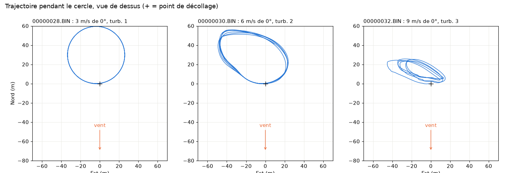

**Détecteur réglé sans vent, évalué sur les vols venteux** (fausses alarmes par vol) :

| Seuil | 3 m/s | 6 m/s | 9 m/s |
|---|---|---|---|
| 2 × max nominal (0,02) | 0 | 10 à 16 | 58 et 70 |
| 3 × max nominal (0,03) | 0 | 0 à 4 | 20 et 30 |
| 5 × max nominal (0,05), persistance 0,5 s | 0 | 0 | 0 et 1 |

**Détecteur calibré en incluant le vent** (validation croisée sur les vols 5 à 19) : aucune
fausse alarme sur 2 250 s, mais le seuil de SV monte de 0,02 à 0,24 ; le biais de
0,5 m/s² n'est plus détecté qu'en 2,1 s (par SP) au lieu de 0,7 s, et plus du tout avec
un seuil de 5 × max nominal. C'est le compromis entre sensibilité et fausses alarmes.

**Pannes sous vent (vols 20 à 31, 6 m/s)** : trois vols par panne, avec trois directions de
vent (0°, 90°, 180°) et trois instants d'injection, donc trois caps différents au début de
la panne. Même détecteur calibré en validation croisée sur les vols 5 à 31 (seuil 2 × max
nominal, persistance 0,5 s) : les 17 pannes de la série sont détectées, aucune fausse
alarme sur 3 693 s de nominal.

| Panne | Sans vent | Sous vent de 6 m/s (3 vols) | Délai de l'EKF (≥ 1) sous vent |
|---|---|---|---|
| Biais 0,5 m/s² | 2,1 s (SP) | 2,2 s en moyenne (2,1 à 2,3 s, SP) | jamais |
| Biais 1,0 m/s² | 1,5 s (SV + SP) | 1,5 s (×3) | jamais |
| Magnétomètre | 0,5 s (SM) | 0,5 s (×3) | 29,8 s, 29,1 s, jamais (selon le cap) |
| Coupure GPS 60 s | 0,7 s (perte du fix) | 0,7 s (×3) | jamais |

Les délais sont quasi identiques d'un vol à l'autre, quels que soient la direction du vent et
le cap d'injection. Les délais de 0,5 et 0,7 s correspondent au plancher imposé par la
persistance de 0,5 s. Avec un seuil de 5 × max nominal, 3 pannes sur 17 sont manquées. Ce qui
varie le plus est la durée de l'état dégradé après le retrait (biais 1,0 : 37 à 53 s ;
magnétomètre : 82 à 90 s). Limites : trois vols par panne, un seul niveau de vent, direction
du vent et cap d'injection modifiés ensemble.

## Limite de détection (vols 32 à 35)

Biais de 0,2 et 0,3 m/s², sans vent et sous vent de 6 m/s, avec le même détecteur
(validation croisée sur les vols 5 à 35, seuils SV / SP / SM = 0,24 / 0,04 / 0,08) : le biais
de 0,2 m/s² n'est détecté ni sans vent ni sous vent ; le biais de 0,3 m/s² l'est en 3,1 s
sans vent et 3,7 s sous vent (par SP). La limite de détection de ce détecteur se situe entre
0,2 et 0,3 m/s². Sans vent, le maximum de SV pendant la panne suit à peu près le biais
(0,08 / 0,12 / 0,21 / 0,42 pour 0,2 / 0,3 / 0,5 / 1,0 m/s², soit SV ≈ 0,42 × biais). Un
détecteur calibré uniquement sur les vols sans vent (seuils 0,02) détecte le biais de 0,2 m/s²
en 1,1 s, mais il est inutilisable dès qu'il y a du vent (voir le tableau plus haut). Un vol
par amplitude.

## Seuil adaptatif, testé sur des vols jamais vus (vols 36 à 58)

Plutôt qu'un seuil unique, réglé pour le pire vent rencontré, le seuil de chaque canal suit le
niveau récent des innovations : seuil = max(0,02 ; moyenne + k × écart-type) sur les 30 s qui
précèdent (fenêtre décalée de 2 s), figé pendant une alarme pour que la panne ne relève pas son
propre seuil. Persistance 0,5 s et règle GPS identiques au seuil fixe. Le réglage (k, fenêtre,
plancher) a été choisi sur les vols 5 à 35, puis figé avant les vols 36 à 58, qui servent de
test : 3 026 s de nominal et 17 pannes, sous des vents de 0 à 9 m/s, dont des vitesses et des
directions jamais vues. Le seuil fixe est calibré sur les vols 5 à 35.

| Panne (vols de test) | Seuil fixe | Seuil adaptatif, k = 6 |
|---|---|---|
| Biais 0,2 m/s², 3 m/s | manqué | 1,5 s (SV) |
| Biais 0,2 m/s², 6 m/s (×2) | 22,7 et 23,7 s (SP) | 4,6 s (SM, ×2) |
| Biais 0,3 m/s², 3 m/s | 2,9 s (SP) | 1,1 s (SV) |
| Biais 0,3 m/s², 6 m/s (×2) | 3,5 et 3,7 s (SP) | 1,5 et 1,9 s (SV) |
| Biais 0,5 m/s², 3 et 9 m/s (×3) | 2,1 à 2,9 s (SP) | 0,9 à 1,9 s (SV) |
| Biais 1,0 m/s², 9 m/s (×2) | 1,7 s (SV) | 1,1 et 1,3 s (SV) |
| Magnétomètre, 3 et 9 m/s (×3) | 0,5 s (SM) | 0,5 s (SM) |
| Coupure GPS 60 s, 3 et 9 m/s (×3) | 0,7 s (perte du fix) | 0,7 s (perte du fix) |
| **Fausses alarmes (3 026 s de nominal)** | **0** | **0** |

Avec k = 4, les 17 pannes sont aussi détectées, un peu plus vite, mais avec 2 fausses alarmes
(vol 40, 7,5 m/s) : SM passe à 0,03 alors que le seuil est au plancher de 0,02, les
innovations étant arrondies au centième. Sur les vols de réglage, k = 4 semblait pourtant le
meilleur choix (k = 6 y manquait le biais de 0,2 m/s² sous vent) : le test sur des vols
nouveaux a inversé le classement. Le seuil calibré sans vent (0,02) fait 501 fausses alarmes
sur ces mêmes vols.

Limites : un seul vol par configuration ; pour les petits biais sous vent, l'alarme ne reste
pas active pendant toute la panne (20 à 36 % de la durée de panne pour les vols 47 à 49) :
une fois l'alarme retombée, la fenêtre contient des valeurs de panne et le seuil remonte. Un
seuil adaptatif peut ainsi « absorber » une panne lente.

**Vent fort (9 m/s)** : les innovations pendant un biais sont plus fortes que sans vent
(maximum de SV 0,33-0,35 pour 0,5 m/s², 0,58-0,61 pour 1,0 m/s², contre 0,21 et 0,42), la
relation SV ≈ 0,42 × biais ne vaut donc que sans vent. Au vol 58 (coupure GPS sous 9 m/s
venant de 90°), le drone a dérivé sous le vent jusqu'à environ 900 m du point de départ
pendant la coupure, sans que l'EKF le voie (sans GPS, il suppose une vitesse nulle et
n'estime pas le vent dans cette configuration) ; au retour du GPS, il remonte le vent en
butée d'inclinaison (30°, `ATC_ANGLE_MAX`) à environ 1 m/s et n'était pas revenu à la fin du
vol. La panne et les 90 s qui suivent sont complètes dans le log. Au vol 54 (même panne, vent
de 0°), la dérive mesurée n'a pas dépassé 116 m : différence non expliquée.

## Détecteur ML : Isolation Forest (mêmes vols de test)

Un Isolation Forest (scikit-learn) est entraîné **uniquement sur du vol nominal** (vols 5 à 35,
3 454 s) : il n'a jamais vu de panne. Ses arbres découpent les données au hasard ; un point
anormal est isolé en peu de coupes. Pour chaque canal (SV, SP, SM), il reçoit 4 variables
calculées sur le passé seulement : valeur instantanée, moyenne et maximum sur 3 s, et
écart-type sur 30 s décalé de 2 s, qui mesure l'agitation du moment (indicateur indirect du
vent, que l'EKF n'estime pas ici). Alarme si le score d'anomalie dépasse le plus haut score
vu sur le nominal d'entraînement pendant 0,5 s, ou si le GPS perd son fix 3D. Réglages fixés
avant le test.

| Panne (vols de test) | Seuil fixe | Seuil adaptatif, k = 6 | Isolation Forest |
|---|---|---|---|
| Biais 0,2 m/s², 3 m/s | manqué | 1,5 s | 2,8 s |
| Biais 0,2 m/s², 6 m/s (×2) | 22,7 et 23,7 s | 4,6 s (×2) | 3,5 et 3,0 s |
| Biais 0,3 m/s² (×3) | 2,9 à 3,7 s | 1,1 à 1,9 s | 2,0 à 2,8 s |
| Biais 0,5 m/s² (×3) | 2,1 à 2,9 s | 0,9 à 1,9 s | 1,5 à 2,0 s |
| Biais 1,0 m/s² (×2) | 1,7 s | 1,1 et 1,3 s | 1,5 et 1,6 s |
| Magnétomètre (×3) | 0,5 s | 0,5 s | 1,7 à 2,7 s |
| Coupure GPS 60 s (×3) | 0,7 s | 0,7 s | 0,7 s |
| Part de la panne en alarme, biais 0,2-0,3 sous 6 m/s (vols 47 à 49) | 2 à 17 % | 20 à 36 % | 64 à 82 % |
| **Fausses alarmes (3 026 s de nominal)** | **0** | **0** | **0** |

Le modèle détecte les 17 pannes. Il est un peu plus lent que le seuil adaptatif sur la
plupart d'entre elles, mais plus rapide sur le cas le plus difficile (biais de 0,2 m/s² sous
vent), et surtout il garde l'alarme active pendant la panne au lieu de l'« absorber ». Son
état dégradé après retrait dure plus longtemps (souvent encore actif 90 s après le retrait
pour le biais de 1,0 m/s² et le magnétomètre).

**Lenteur sur la panne magnétomètre (vérifiée au vol 45)** : le score saute dès le premier
échantillon de panne puis plafonne, que SM vaille 0,39 ou 0,98. Un Isolation Forest mesure
combien de variables sortent du domaine vu à l'entraînement, pas de combien elles en sortent :
il n'extrapole pas. L'alarme n'est franchie qu'une fois la moyenne sur 3 s sortie à son tour
du domaine connu.

**Robustesse au tirage aléatoire** (graines 0 à 4, mêmes réglages) : 17 / 17 pannes détectées
pour les cinq graines, délais stables à ± 0,5 s près ; 0 fausse alarme pour quatre graines,
3 pour la cinquième (vols 40 et 51, score à peine au-dessus du seuil, aux mêmes instants que
les fausses alarmes du seuil adaptatif avec k = 4). Le tableau ci-dessus utilise la graine 0,
un tirage plutôt favorable. Avec un seuil égal au maximum vu à l'entraînement, la marge est
mince ; il n'a pas été retouché après avoir vu les vols de test. Un seul vol par configuration
de test.

## Test final : 60 vols neufs, dont quatre nouveaux types de panne (vols 65 à 124)

**Réglages faits sur le jeu de validation (vols 36 à 58), avant la campagne** : le seuil de
l'Isolation Forest devient le plus haut score nominal d'entraînement + 0,02 (sur cinq graines, une
marge de 0,01 suffit à supprimer les fausses alarmes, 0,02 en garde une de plus) ; 200 arbres
(500 n'apportent rien) ; et une combinaison, alarme si l'Isolation Forest **ou** le seuil
adaptatif se déclenche, qui ramène le délai moyen d'environ 2,3 s à environ 1,4 s sans ajouter
de fausse alarme. Les quatre détecteurs ont ensuite été figés, puis évalués **une seule fois**
sur la campagne de test. Entraînement et calibration : vols 5 à 35, comme avant. La campagne
comprend 18 vols nominaux, 18 vols avec les pannes déjà connues et 24 vols avec quatre pannes
nouvelles : dérive lente d'accéléromètre (biais qui croît linéairement de 0 à sa valeur finale
pendant les 60 s de panne), biais de gyroscope, bruit de gyroscope et accéléromètre bloqué sur
une seule IMU.

| Panne (vols de test) | Seuil fixe | Seuil adaptatif, k = 6 | Isolation Forest | ML + adaptatif |
|---|---|---|---|---|
| Biais 0,2 m/s² (×3) | manqué (×3) | 1,3 à 2,6 s | 3,2 à 4,3 s | 1,3 à 2,6 s |
| Biais 0,3, 0,5 et 1,0 m/s² (×9) | 1,5 à 3,3 s | 0,7 à 1,7 s | 1,5 à 2,8 s | 0,7 à 1,5 s |
| Magnétomètre (×3) | 0,5 s | 0,5 s | 2,3 à 2,7 s | 0,5 s |
| Coupure GPS 60 s (×3) | 0,7 s | 0,7 s | 0,7 s | 0,7 s |
| Dérive 0,3 m/s² (×3) | 1 / 3 (53,7 s) | manqué (×3) | 21,9 à 30,1 s | 21,9 à 30,1 s |
| Dérive 0,5 m/s² (×3) | 28,3 à 54,0 s | manqué (×3) | 16,5 à 23,9 s | 16,5 à 23,9 s |
| Dérive 1,0 m/s² (×3) | 19,1 à 19,4 s | 1 / 3 (13,4 s) | 10,3 à 12,9 s | 10,3 à 12,9 s |
| Biais gyroscope 0,01 et 0,02 rad/s (×6) | 1,7 à 4,3 s | 0,8 à 1,5 s | 1,9 à 3,1 s | 0,8 à 1,5 s |
| Bruit gyroscope 30 (×3) | manqué (×3) | manqué (×3) | 2 / 3 (4,5 et 12,3 s) | 2 / 3 |
| Bruit gyroscope 60 (×3) | 1 / 3 (12,9 s) | 2,3 à 9,1 s | 3,7 à 8,7 s | 2,3 à 8,7 s |
| Accéléromètre bloqué, IMU 1 (×3) | 0,5 à 0,7 s | 0,5 à 0,7 s | 1,4 à 9,5 s | 0,5 à 0,7 s |
| **Pannes détectées** | **32 / 42** | **31 / 42** | **41 / 42** | **41 / 42** |
| **Fausses alarmes (8 217 s de nominal)** | **0** | **0** | **0** | **0** |

**La dérive lente piège le seuil adaptatif**, comme on pouvait le craindre : sa fenêtre de 30 s
suit la montée de la panne et le seuil reste toujours au-dessus de l'innovation (8 dérives
manquées sur 9). L'Isolation Forest, dont la référence est le nominal d'entraînement, fixe, les
détecte toutes. Les délais sur les dérives sont longs par nature : au moment de la détection, le
biais n'a atteint qu'une fraction de sa valeur finale.

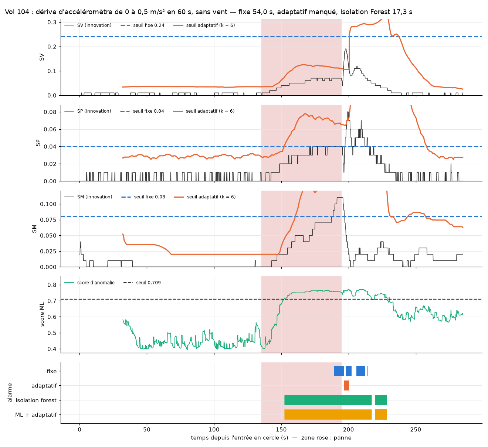

**La combinaison prend le meilleur des deux** sur chaque vol : la réactivité du seuil adaptatif
sur les pannes franches (magnétomètre en 0,5 s au lieu de 2,3-2,7 s, accéléromètre bloqué en
0,5-0,7 s au lieu de 1,4-9,5 s, la saturation du score de l'Isolation Forest le ralentissant) et
la sensibilité de l'Isolation Forest aux pannes lentes, sans aucune fausse alarme ajoutée. Le
seuil fixe, calibré pour le vent le plus fort, ne voit plus le biais de 0,2 m/s². La seule panne
manquée par les quatre détecteurs est le bruit de gyroscope le plus faible, sans vent (vol 116) :
les innovations restent sous 0,03, l'EKF filtre presque tout ce bruit.

Observations sur le déroulé : l'accéléromètre bloqué fait basculer ArduPilot sur son second cœur
EKF 0,3 s après l'injection (les détecteurs lisent le cœur 0, qui voit une panne très franche) ;
pendant les coupures GPS, le drone dérive de 390 à 540 m sous le vent avant de revenir ; au vol 94
(biais de 1,0 m/s² sous 9 m/s), l'altitude descend à 13,8 m juste après le retrait de la panne.

Limites : trois vols par configuration ; 0 fausse alarme sur 60 vols signifie seulement, d'après
la règle de trois, que le taux réel est probablement inférieur à environ 5 % des vols ;
simulation sans vibrations des moteurs ; une seule graine pour l'Isolation Forest.

## Détecteur en vol (vols 125 à 128)

Jusqu'ici, les alarmes étaient calculées après le vol, sur le log complet. Pour pouvoir un jour
déclencher une récupération, le détecteur doit décider pendant le vol, à chaque nouvelle mesure,
sans connaître la suite. Les quatre détecteurs ont donc été réécrits pour traiter un échantillon
à la fois (`scripts/detecteur_en_ligne.py`), avec les réglages figés du test final, et branchés
sur le vol automatique (`vol_auto.py --detecteur`). En vol, les innovations arrivent par le
message MAVLink `EKF_STATUS_REPORT`, demandé à 10 Hz : d'après le code d'ArduPilot, ce sont les
mêmes grandeurs que XKF4, mais celles du cœur EKF principal et sans l'arrondi au centième du log,
que le détecteur reproduit. Le détecteur ne fait que signaler : il n'agit pas sur le drone.

Deux vérifications :

- **Sans voler** : les 60 vols de test, rejoués un échantillon à la fois dans le détecteur en
  vol, donnent exactement les mêmes alarmes que l'analyse après coup, à chaque instant (0 écart).
  Les résultats du test final n'utilisaient donc aucune mesure future. Calcul : environ 6 ms par
  échantillon, pour 100 ms disponibles.
- **En vol** (vols 125 à 128, `scripts/comparer_en_ligne.py`) : la trace écrite pendant le vol
  est comparée à l'analyse du log du même vol. Un message toutes les 100 ms (99,9 % des
  intervalles entre 80 et 120 ms, plus long trou 120 ms) ; horloges décalées d'au plus 0,05 s ;
  valeurs identiques à celles du log à 100 % sur trois vols, et à 95,4 % sur le vol 126, où les
  écarts sont presque tous un décalage d'un échantillon (8 échantillons sur 2 700 restent
  inexpliqués).

| Vol | Panne | Seuil fixe | Seuil adaptatif | Isolation Forest | ML + adaptatif |
|---|---|---|---|---|---|
| 125 | aucune (vent 6 m/s) | — | — | — | — |
| 126 | biais 0,3 m/s² | 3,0 s (2,9 s après coup) | 1,1 s | 2,4 s | 1,1 s |
| 127 | magnétomètre | 0,5 s | 0,5 s | 2,5 s | 0,5 s |
| 128 | dérive 0,5 m/s² | 55,3 s | après le retrait | 19,8 s | 19,8 s |

Délais en vol, identiques à l'analyse après coup sauf mention, et aucune fausse alarme. Critère
fixé avant les vols (mêmes pannes détectées, délais à ± 0,3 s, aucune fausse alarme) : respecté
sur les quatre vols. Limites : un vol par panne ; le détecteur tourne sur l'ordinateur qui pilote
la simulation, comme sur une station sol, et la simulation tourne sur la même machine (ni vraie
radio, ni pertes de messages).

## Récupération, partie A : naviguer sans GPS (vols 129 à 131)

Atterrir dès qu'une panne est détectée, c'est ce que fait déjà ArduPilot par défaut, et c'est
abandonner la mission, ce qui n'a pas de sens dans un environnement où le GPS est brouillé. La
récupération visée est donc un **mode dégradé** : écarter le capteur fautif et continuer la
mission (ici, le cercle de surveillance), l'atterrissage restant le dernier recours. Cette
première partie vérifie les moyens que donne ArduPilot pour naviguer sans GPS, lus dans son code
(commit `14c871f`) puis testés en vol :

- **Pourquoi le drone dérive sans GPS** : l'EKF n'estime pas le vent sur un multicoptère tant
  que le modèle de traînée est désactivé (par défaut). Sans GPS, il suppose une vitesse nulle, et
  au bout de 15 s il cesse de naviguer (« stopped aiding ») : le drone dérive sans le savoir.
- **Le levier** : les coefficients de traînée (`EK3_DRAG_BCOEF_X/Y` 9,5, `EK3_DRAG_MCOEF` 0,082,
  valeurs du test `DeadReckoningInWind` d'ArduPilot pour ce simulateur) font estimer le vent
  tant que le GPS est là, et la traînée compte alors comme une mesure : sans GPS, l'EKF ne
  passe pas en « stopped aiding » et continue de naviguer à l'estime.
- **Ce que la traînée ne fait pas** (vérifié après coup dans le code) : pendant la navigation à
  l'estime, l'EKF tient son estimation du vent pour exacte (variance mise à zéro,
  `AP_NavEKF3_core.cpp:1112-1117`), et la fusion de la traînée ne corrige que les états de vent
  (`AP_NavEKF3_AirDataFusion.cpp:505-508`). Elle ne corrige donc plus ni la vitesse ni la
  position : la navigation à l'estime est une intégration inertielle pure (au vol 130, le vent
  estimé reste figé au centième près pendant toute la coupure).
- **Ignorer le GPS volontairement** : ArduPilot a trois jeux de sources de navigation, et la
  commande MAVLink `MAV_CMD_SET_EKF_SOURCE_SET` fait passer de l'un à l'autre en vol. Un jeu
  sans GPS permettrait d'écarter un GPS leurré, qui se dit sain.

Erreur de navigation réelle (position du simulateur contre position estimée par le cœur EKF
principal, `scripts/erreur_navigation.py`), sous un vent de 6 m/s venant du nord :

| Vol | Situation | Vent estimé | Erreur de navigation max | Temps dans la zone surveillée (< 60 m du centre) |
|---|---|---|---|---|
| 16 | nominal, sans traînée | non estimé | 0,3 m | 100 % |
| 129 | nominal, avec traînée | 5,84 m/s venant de 359° | 0,3 m | 100 % |
| 23 | coupure GPS de 60 s, sans traînée | non estimé | **232 m** | **40 %** de la coupure (jusqu'à 266 m du centre) |
| 130 | coupure GPS de 60 s, avec traînée | 5,85 m/s venant de 359° | **7,6 m** | **100 %** |
| 131 | GPS écarté par l'EKF pendant 60 s, avec traînée | 5,86 m/s venant de 359° | 14 m | 100 % |

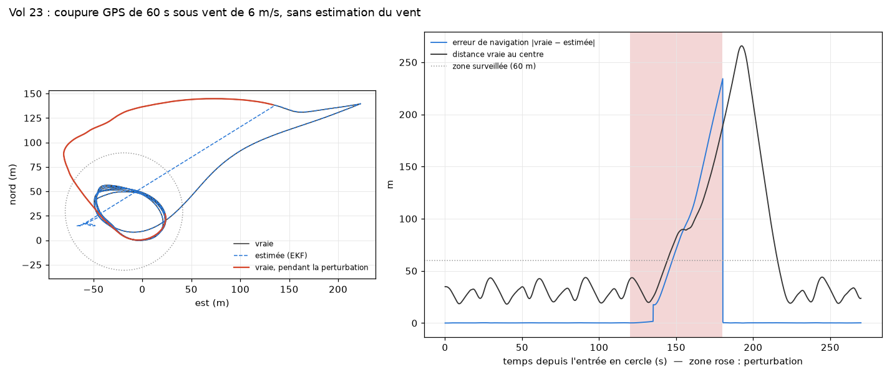
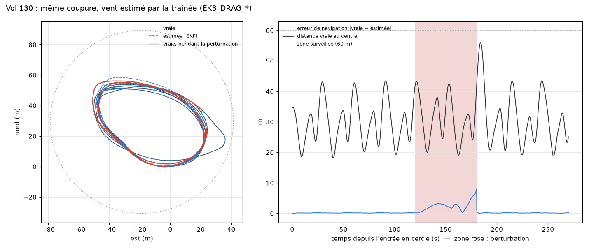

Avec la traînée, le drone reste sur son cercle pendant toute la coupure. Ce résultat est à lire
avec prudence : la traînée évite le passage en « stopped aiding », mais la précision pendant la
coupure vient de l'IMU simulée, sans bruit ni vibration dans nos vols. Sur un vrai drone,
l'intégration inertielle pure dériverait beaucoup plus vite (non mesuré ici). Elle varie aussi
d'un vol à l'autre : sur la campagne suivante (R3 v2, pas encore décrite ici), sous un vent venant
de l'est, l'erreur a atteint 34 m après 60 s sans GPS. Le détecteur ne fait
aucune fausse alarme sur le vol nominal avec traînée (innovations maximales identiques à celles
du vol 16). Limites : un vol par cas, un seul vent, constant pendant la coupure (le test
d'ArduPilot signale qu'un vent qui change pendant la navigation à l'estime est le cas
difficile). Une fois le GPS écarté, ses innovations ne sont plus mises
à jour : le détecteur ne peut plus dire quand le GPS redevient fiable, il faudra un autre critère.

## Récupération, partie B : brouillage et leurrage GPS (vols 132 à 149)

**La réponse proposée, R3** (`scripts/recuperation.py`, `vol_auto.py --reponse r3`), traînée activée :

- **écarter le GPS** (bascule sur le jeu de sources sans GPS) si le fix 3D est perdu pendant
  0,5 s, ou si le seuil adaptatif donne l'alarme d'abord sur l'innovation de position (SP) seule
  alors que le fix est bon. Les innovations disent qu'il y a un désaccord, pas qui a tort : un
  biais d'accéléromètre peut aussi faire monter SP, d'où un vol témoin. Seul le seuil adaptatif
  sert à cette décision, car l'Isolation Forest ne dit pas quel canal est en cause ;
- une fois le GPS écarté, ses innovations ne sont plus mises à jour (ArduPilot renvoie la dernière
  valeur calculée), le détecteur ne peut donc plus juger le GPS : la décision est mémorisée. **Retour au GPS** quand sa position reste à moins de 25 m de la position estimée à
  l'estime pendant 5 s (25 m : rayon au-delà duquel l'EKF se recale lui-même sur le GPS) ;
  pas de nouvelle exclusion pendant 10 s après un retour ; **RTL en dernier recours** après
  2 minutes sans GPS fiable.

**Comparée à** : R0 rien (`FS_EKF_ACTION 0`) ; R1 ArduPilot par défaut (atterrissage sur
failsafe EKF) ; R2 ArduPilot par défaut avec la traînée (et donc son retour au point de départ dès
qu'il navigue à l'estime). Pannes simulées : brouillage (`SIM_GPS1_JAM` : perte du signal puis
fix, satellites, position et vitesse erratiques), leurre de 100 m vers le nord en échelon ou en
rampe sur 60 s (`SIM_GPS1_GLTCH_X`, fix et vitesse GPS corrects). Un vol par case, vent 6 m/s
venant du nord, panne de 120 à 180 s ; mesures de `scripts/erreur_navigation.py` pendant la
panne (zone surveillée : 60 m autour du centre du cercle).

| Panne | R0 rien | R1 ArduPilot | R2 ArduPilot + traînée | R3 |
|---|---|---|---|---|
| Brouillage (vols 133 à 136) | erreur 2 657 m, 51 % dans la zone | atterrissage à 124,9 s, posé à ≈ 180 m | atterrissage à 124,9 s | **erreur 9 m, 100 %, mission poursuivie** |
| Leurre en échelon (137 à 140) | 100 m, 34 % | 100 m, 33 %, aucun failsafe | retour au départ à 130 s, vers une position faussée | **5,3 m, 100 %** |
| Leurre en rampe (141 à 144) | 98,5 m, 57 % | identique | identique, retour au départ à 190 s | **98,5 m, 57 % : échec** |
| Témoin : biais d'accéléromètre 0,5 m/s² (145 à 148) | 0,5 m, 100 % | identique | identique | identique, **GPS non écarté** |
| Nominal (149) | | | | aucune action |

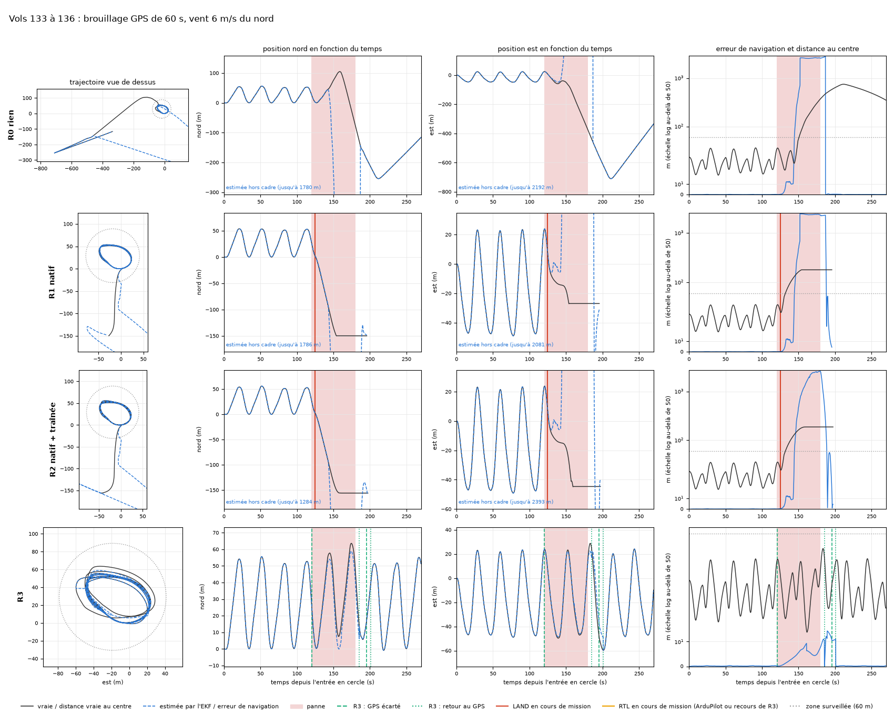
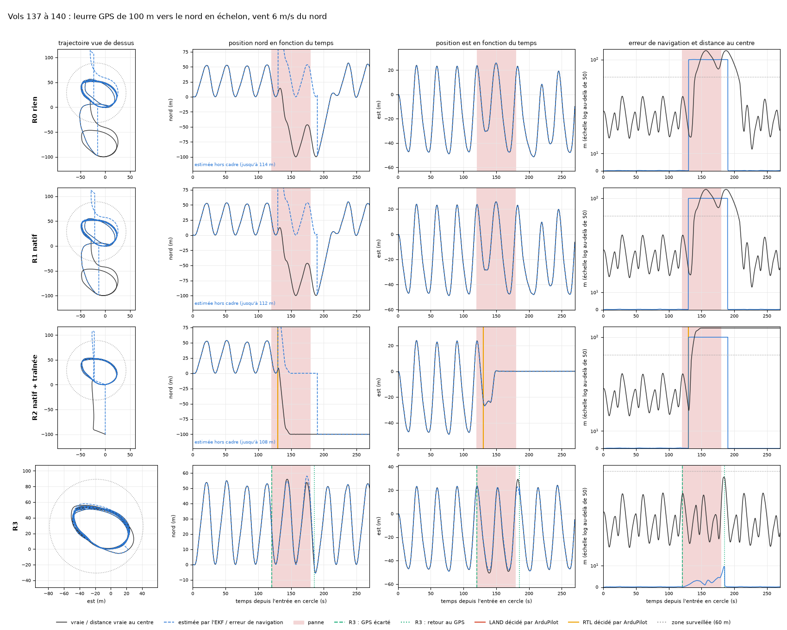

- **Brouillage** : le récepteur brouillé fournit par moments des positions et des vitesses fausses
  avec un fix valide, et l'EKF les accepte (plus de 2,6 km d'erreur). ArduPilot atterrit en
  4,9 s, sous le vent et hors de la zone. R3 écarte le GPS en 0,6 s et garde le cercle.
- **Leurre en échelon** : l'EKF rejette d'abord le saut, puis, son incertitude dépassant 25 m,
  se recale sur la fausse position au bout d'environ 10 s ; le drone tourne alors 100 m trop au
  sud en croyant être sur son cercle. Le failsafe d'ArduPilot ne voit rien ; avec la traînée, son
  retour au départ se fait vers la position faussée. R3 écarte le GPS en 0,5 s, avant que l'EKF
  ne l'accepte : c'est le cas où un détecteur par innovations apporte le plus.
- **Leurre en rampe : R3 échoue.** Il écarte le GPS en 0,6 s, mais 5 s plus tard le leurre n'a
  décalé la position que de 8,6 m, sous les 25 m : R3 conclut que le GPS est redevenu cohérent et
  y revient, puis l'EKF suit le leurre. Un leurre qui avance à la vitesse *v* ne dépasse 25 m
  qu'au bout de 25 / *v* secondes : il faudrait observer plus longtemps avant de revenir, et un
  leurre plus lent que la dérive de la navigation à l'estime resterait de toute façon invisible
  avec cette méthode.

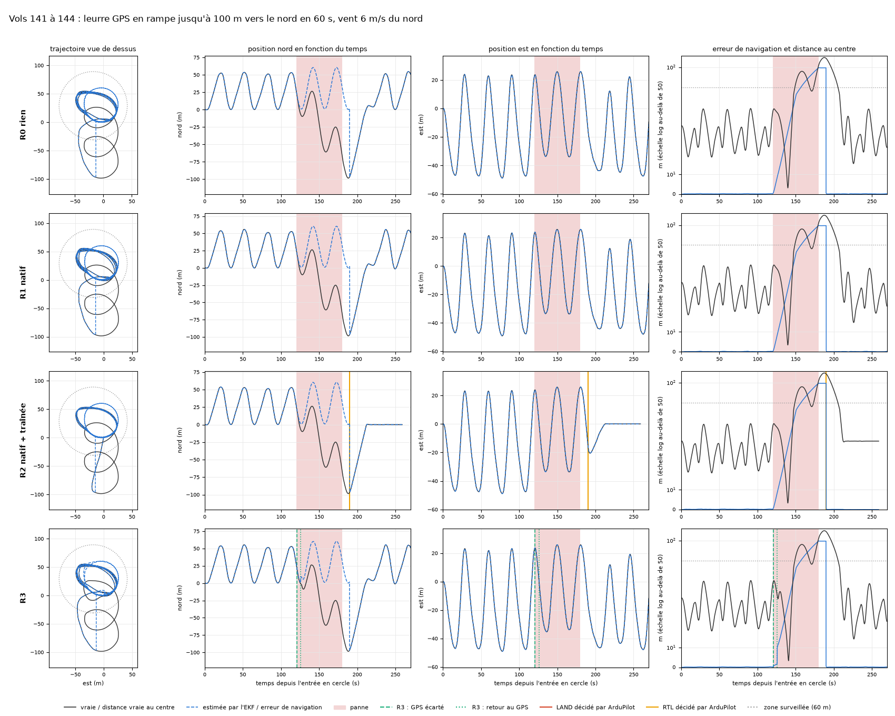

- **Témoin** : le biais d'accéléromètre fait monter SV en premier, R3 n'écarte pas le GPS ; avec
  un GPS sain, l'EKF compense ce biais seul (0,5 m d'erreur pour toutes les réponses).
- R3 a fait une exclusion à tort, brève (5 s), 10 s après son retour au GPS à la fin du
  brouillage, pendant le recalage de l'EKF.

Limites : un vol par case, un seul vent et un seul cap à l'injection ; le vol témoin ne couvre
qu'une configuration, alors que d'autres vents avaient fait réagir SP en premier à un biais
d'accéléromètre avec le seuil fixe ; leurres simplifiés (vitesse GPS non décalée). Constaté
après la campagne dans les traces : pendant l'exclusion, la valeur figée de SP (26,41 après le
leurre en échelon) continue d'alimenter le détecteur, si bien qu'après le retour au GPS le seuil
adaptatif de SP, calculé sur les 30 dernières secondes, reste très haut et ce canal est aveugle
environ 30 s ; l'exclusion à tort après le brouillage vient d'une alarme due au recalage de
l'EKF, commencée pendant le délai de 10 s et encore active à sa fin.

## Récupération, R3 v2 : validation sur 30 vols neufs (vols 150 à 179)

**Changements par rapport à la v1**, décidés après la partie B : retour au GPS seulement après
**30 s** de cohérence (au lieu de 5 s ; 25 m en 30 s, soit un leurre plus lent qu'environ
0,8 m/s, reste invisible) ; pendant l'exclusion, le détecteur n'est plus alimenté, et
l'épisode d'alarme qui a déclenché l'exclusion est retiré de sa mémoire, pour qu'au retour son
seuil adaptatif reparte du nominal d'avant la panne (sans exclusion, alarmes inchangées sur les
60 vols de test rejoués) ; seul un épisode d'alarme commencé plus de 10 s après un retour peut écarter de
nouveau le GPS.

**Plan** : vent 6 m/s venant de 90°, 180° ou 270° (turbulence 2), injection à 128, 135 ou
143 s de cercle selon le vol, panne de 60 s ; chaque panne avec R0 (rien) et R3 v2, un vol par
vent. Leurre de 100 m en échelon et en rampe, leurre en rampe jusqu'à 30 m (0,5 m/s, sous la
limite de 0,8 m/s, pour mesurer cette limite), brouillage ; cinq vols témoins avec R3 v2
(biais d'accéléromètre 0,5 m/s² sous les trois vents, biais 0,3, dérive 0,5) et trois nominaux.

| Panne | R0 rien | R3 v2 |
|---|---|---|
| Leurre en échelon (vols 150 à 155) | erreur 100 m, 30 à 41 % dans la zone pendant la panne | vent 180° : **17 m pendant la panne, 26 m après, 100 %**, retour au GPS ; vents 90° et 270° : 34 m et 10 m pendant la panne, puis **échec** (211 m et 58 m) |
| Leurre en rampe jusqu'à 100 m (156 à 161) | 98 m, 57 à 69 % | vent 270° : **16 m pendant, 21 m après, 100 %**, retour au GPS ; vents 90° et 180° : **échec** (196 m et 152 m après la panne) |
| Leurre en rampe jusqu'à 30 m (162 à 165) | 29,5 m, 94 à 100 % | 29,5 m : retour au GPS leurré pendant la panne, **aucun gain** (limite attendue) |
| Brouillage (166 à 171) | **1 500 à 2 300 m**, 0 % dans la zone après la panne | **9 à 28 m pendant la panne, 100 %** ; puis **échec** dans les trois cas (26 à 114 m après) |
| Témoins (172 à 176) et nominaux (177 à 179) | | **GPS jamais écarté**, erreur ≤ 0,6 m |

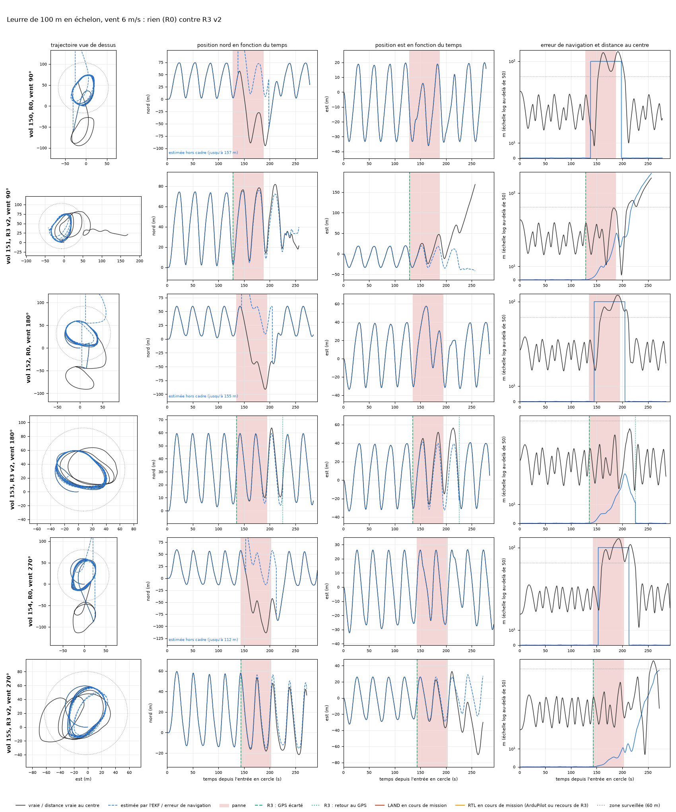
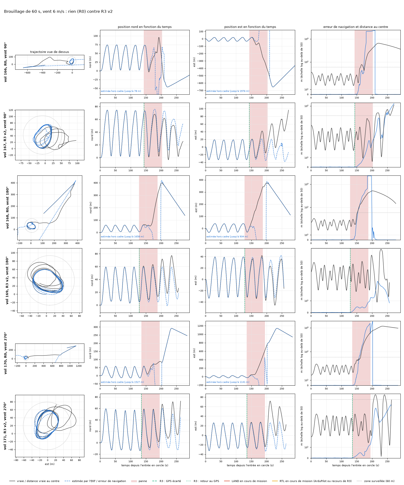

**Sept échecs sur quinze vols R3, tous de la même façon** (vérifié dans les messages de chaque
log) :

1. R3 écarte le GPS ; environ 10 s plus tard l'EKF déclare la navigation à l'estime
   (« Dead Reckoning started »).
2. Pendant l'exclusion, la navigation est une intégration inertielle pure (voir la partie A) :
   l'erreur de vitesse n'est corrigée par rien. Au vol 151, l'écart entre vitesse estimée et
   vitesse vraie passe de 0,4 m/s à 5,3 m/s, sur l'axe du vent ; au vol 153, il reste entre 0,4
   et 0,8 m/s. Cause de cette différence non établie.
3. 30 s après le début de la navigation à l'estime, Copter cesse d'accepter la position estimée
   (`FS_DR_TIMEOUT` 30 s, « Dead Reckoning timeout » puis « EKF variance: position lost »). Ce
   délai ne change pas le calcul de l'EKF (`ArduCopter/events.cpp:350-357`), mais il rend
   impossibles les modes qui demandent une position.
4. Panne de 60 s plus 30 s de cohérence : une exclusion dure au moins 90 s. Quand l'erreur à
   l'estime dépasse 25 m, le GPS redevenu sain ne passe plus le critère de retour (écart de
   position < 25 m) ; au bout de 2 minutes, le RTL de dernier recours est **refusé** par ArduPilot
   (« requires position »), et `vol_auto.py` s'arrête. Les mesures « après la panne » de ces vols
   s'arrêtent donc à ce moment (249 à 264 s de cercle).

Les deux réussites sur les leurres de 100 m viennent de vols où l'erreur à l'estime est restée
sous 25 m. La v1 avait réussi le brouillage parce qu'elle revenait au GPS au bout de 5 s, avant
que l'erreur ne grandisse. Le gain sur la panne elle-même reste net (brouillage : 9 à 28 m contre
1,5 à 2,3 km ; aucune exclusion à tort sur les 8 vols témoins et nominaux), mais le critère de
retour au GPS et le dernier recours sont à revoir.

Limites : un vol par case ; vent de 6 m/s seulement ; IMU simulée sans bruit, donc navigation à
l'estime plus précise que sur un vrai drone.

## Récupération, R3 v3 : validation sur 30 vols neufs (vols 180 à 209)

**Changements par rapport à la v2**, un par étape d'échec :

- **tolérance de retour qui grandit avec la durée sans GPS** : le GPS est repris quand sa
  position reste pendant 30 s à moins de 25 m + 0,6 m/s × (temps depuis l'exclusion) de la
  position estimée. Mesurée sur les vols R3 v2, la dérive à l'estime atteignait 25 à 77 m 90 s
  après l'exclusion. Le taux de 0,6 m/s est le plus petit qui, rejoué après coup sur ces vols,
  aurait repris le GPS sain dans les 9 cas. Contrepartie prévue par ce rejeu (qui supposait
  l'estimée exacte) : un leurre en échelon de moins d'environ 79 m, ou en rampe plus lent
  qu'environ 1,4 m/s, peut être accepté ;
- **`FS_DR_TIMEOUT` à 120 s** (maximum documenté, défaut 30 s) avec R3, pour que Copter accepte
  encore la position estimée au moment du dernier recours ;
- **LAND si ArduPilot refuse le RTL** de dernier recours.

**Plan** : celui des vols 150 à 179, avec un vent venant de 45°, 135° ou 225° pour ne pas
valider sur les vols qui ont servi au réglage.

| Panne | R0 rien | R3 v3 |
|---|---|---|
| Leurre en échelon (vols 180 à 185) | erreur 100 m, 31 à 42 % dans la zone pendant la panne | **retour au GPS sain dans les trois cas**, 30 s après la fin du leurre ; erreur max 33, 21 et 37 m, 97 à 100 % dans la zone |
| Leurre en rampe jusqu'à 100 m (186 à 191) | 98 m, 52 à 69 % | vent 225° : leurre refusé, **17 m pendant, 38 m après**, retour au GPS sain ; vents 45° et 135° : **GPS leurré repris** 30 s après l'exclusion, 98 m comme sans réponse |
| Leurre en rampe jusqu'à 30 m (192 à 195) | 29,5 m | 29,5 m : GPS leurré repris, **aucun gain** (limite attendue) |
| Brouillage (196 à 201) | **1 170 à 2 470 m**, 0 % dans la zone après la panne | vents 135° et 225° : **16 et 18 m pendant, 22 et 41 m après, 100 %**, retour au GPS ; vent 45° : **dernier recours**, RTL accepté, posé à 472 m du départ |
| Témoins : biais 0,5 m/s² sous les trois vents et 0,3 (202 à 205), nominaux (207 à 209) | | GPS jamais écarté, erreur ≤ 0,6 m |
| Témoin : dérive d'accéléromètre jusqu'à 0,5 m/s² (206) | | **GPS écarté à tort** 33 s après le début de la dérive, erreur jusqu'à 38 m, retour au GPS 30 s plus tard |

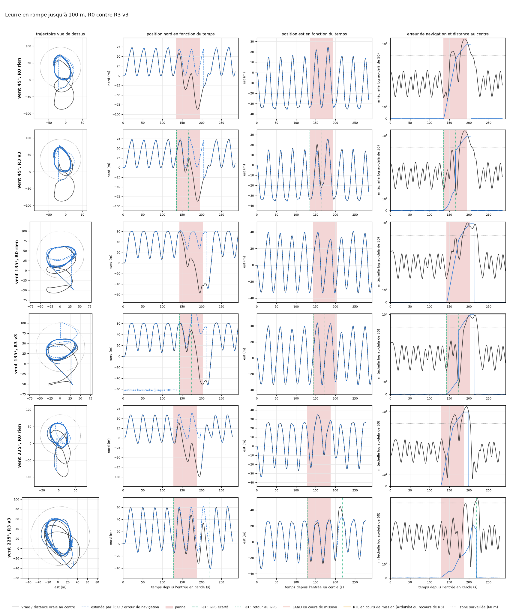
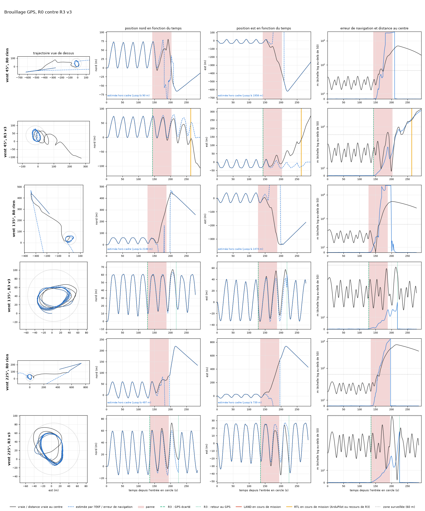

**Ce qui marche** : aucun vol ne s'arrête sur un refus de RTL ; le GPS sain est repris dans
6 cas sur 7 (2 sur 9 en v2) ; sur le leurre en échelon et deux brouillages sur trois, le drone
reste dans la zone surveillée.

**Trois échecs, expliqués dans les logs** :

1. **Leurres en rampe acceptés (vols 187 et 189).** Trente secondes après l'exclusion, le leurre
   décalait le GPS de 51 m vers le nord. Mais la position estimée avait elle-même dérivé de 12 à
   16 m vers le nord : l'écart vu par R3 n'était que de 37 à 39 m, sous la tolérance de 43 m. Au
   vol 191, la dérive n'était que de 5 m : écart de 47 m, leurre refusé. La règle compare le GPS
   à une estimée qui dérive d'environ 0,5 m/s, dans un sens ou dans l'autre ; un leurre lent ou
   une dérive défavorable passe donc d'un côté ou de l'autre. Pourquoi la dérive allait dans le
   sens du leurre sur deux vols n'est pas établi.
2. **Brouillage, vol 197.** Après la fin du brouillage, l'erreur de l'estimée (donc l'écart avec
   le GPS redevenu sain) a suivi la tolérance (72 m pour 70 à +75 s, 79 m pour 79 à +90 s), puis
   l'a dépassée (127 m pour 88 à +105 s) : le GPS n'a jamais été repris. Le RTL de dernier
   recours se fait à l'estime, sans GPS : le drone s'est posé sans dommage, mais à 472 m de son
   point de départ, en se croyant à environ 60 m.
3. **Dérive d'accéléromètre prise pour un leurre (vol 206).** Elle fait monter SP en premier
   avec un fix bon, la signature retenue pour le leurre. Écarter le GPS est alors contre-productif :
   la navigation à l'estime se fait avec l'accéléromètre biaisé.

La v3 n'a pas été retouchée après ces vols : le taux de 0,6 m/s réglé sur six cas ne se
généraliserait pas. Comparer seulement des positions a ici sa limite ; il faudrait une autre
information pour juger le GPS pendant l'exclusion.

Limites : un vol par case ; vent de 6 m/s seulement ; IMU simulée sans bruit (la dérive serait
plus forte sur un vrai drone, voir la section suivante) ; leurres simplifiés (vitesse GPS non
décalée).

## Bruit d'IMU : ce que valent les résultats précédents (vols 210 à 231)

Jusqu'ici, l'IMU simulée n'avait aucun bruit. Ces vols ajoutent un bruit de gyroscope pendant tout
le vol (`vol_auto.py --bruit R` : `SIM_GYR1/2/3_RND = R`, réglé avant le décollage ; amplitude
radians(R) × gaz, sur les trois axes). Niveaux 30 et 60 : choisis d'après un commentaire du
simulateur (`AP_InertialSensor_SITL.cpp:235`) qui annonce 0,2 à 0,4 rad/s pour un vrai
multirotor, soit R ≈ 30 à 60 avec les gaz de nos vols (≈ 0,38). **Ce choix était trop pessimiste**
(voir « Ce que représente ce niveau de bruit » plus bas) : ces vols sont un cas extrême, pas un
drone réaliste. Plan : vent 6 m/s
venant de 20°, 140° ou 260° (turbulence 2), injection à 128, 135 ou 143 s ; pour chaque niveau,
un nominal, une coupure GPS de 60 s avec traînée et un biais de 0,3 m/s² par vent, plus les trois
coupures GPS sans bruit en référence. Détecteurs calibrés comme au test final (logs 19 à 49),
sans aucun réglage retouché.

**Fausses alarmes** (3 010 s de nominal) :

| Détecteur | Sans bruit (vols 229 à 231) | Bruit 30 | Bruit 60 |
|---|---|---|---|
| Seuil fixe | 0 | 0 | **27** |
| Seuil adaptatif | 0 | 0 | 0 |
| Isolation Forest (et combinaison) | 0 | **57** | **90** |

Le bruit relève le niveau nominal des innovations : sur les nominaux à 6 m/s, SP atteint au plus
0,02 sans bruit, 0,03 avec le bruit 30 et 0,07 avec le bruit 60 (SM : 0,02, 0,06 et 0,11). Le
seuil fixe (SP 0,04, SM 0,08) est dépassé au bruit 60 seulement. Pour l'Isolation Forest, toutes
les variables (valeurs, moyennes, écarts-types) sortent dès le bruit 30 du domaine vu à
l'entraînement : il ne peut pas servir tel quel sur une IMU bruitée.

**Biais de 0,3 m/s²** : le seuil adaptatif suit le niveau du bruit, d'où aucune fausse alarme,
mais il ne détecte que 3 biais sur 6 (1,7 à 2,3 s ; manqués aux vols 213, 222 et 228). Le seuil
fixe les détecte tous les trois au bruit 30 (2,3 à 16,7 s, sans fausse alarme) ; au bruit 60, ses
détections tombent au milieu de fausses alarmes et ne prouvent rien. Les délais de 0,0 s de
l'Isolation Forest sont une alarme déjà active à l'injection, pas une détection.

**Navigation à l'estime** (coupure GPS de 60 s avec traînée, erreur vraie en mètres, un vol par
vent) :

| Bruit | +10 s | +30 s | +60 s | Temps dans la zone pendant la coupure |
|---|---|---|---|---|
| 0 (vols 229 à 231) | 1 à 2 | 3 à 12 | 6 à 45 | 90 à 100 % |
| 30 (212, 215, 218) | 4 à 6 | 22 à 39 | 73 à 144 | 73 à 87 % |
| 60 (221, 224, 227) | 9 à 11 | 52 à 60 | 145 à 211 | 40 à 63 % |

Le vol pilote 210 (bruit 60, même vent que le vol 221, injection à 120 s au lieu de 128 s) donne
110 m à +60 s, contre 211 m : la dispersion d'un vol à l'autre est grande. Au bruit 60, un des deux
cœurs EKF arrête de naviguer (« stopped aiding ») malgré la traînée, 16 à 25 s après la coupure,
dans 3 vols sur 4.

**Conséquence pour R3** : 30 s après l'exclusion, sa tolérance de retour vaut 43 m, alors que la
dérive à l'estime atteint déjà 22 à 60 m avec du bruit, et une exclusion dure au moins 90 s. Le GPS
redevenu sain serait presque toujours refusé, et le drone sortirait de la zone pendant
l'exclusion : R3 v3 ne tiendrait pas avec un bruit de ce niveau.

**Ce que représente ce niveau de bruit** (lu dans le code après ces vols, commit `14c871f`) :

- Sans vibration réglée, le simulateur ajoute à chaque échantillon de gyroscope un tirage uniforme
  entre −radians(R) × gaz et +radians(R) × gaz : un bruit blanc (`AP_InertialSensor_SITL.cpp:239-249`).
- L'EKF n'utilise pas le gyroscope filtré à 20 Hz (`INS_GYRO_FILTER`, qui ne sert qu'au pilotage) :
  il intègre les échantillons bruts en angles (`AP_InertialSensor_Backend.cpp:346`,
  `AP_NavEKF3_Measurements.cpp:767`). Tout le bruit blanc lui parvient.
- Avec `INS_FAST_SAMPLE = 1` (valeur par défaut, un masque de bits), seule la première IMU moyenne
  8 tirages par échantillon (`AP_InertialSensor_SITL.cpp:314`). La deuxième IMU, qui alimente le
  deuxième cœur EKF, est donc environ √8 ≈ 2,8 fois plus bruitée : c'est probablement pour cela que
  seul ce cœur a arrêté de naviguer au bruit 60 (non vérifié).
- Exprimé en marche aléatoire d'angle (°/√s, gaz ≈ 0,42), le bruit de la première / deuxième IMU vaut
  0,08 / 0,27 au bruit 30 et 0,16 / 0,53 au bruit 60. L'EKF suppose 0,094 (`EK3_GYRO_P_NSE` = 0,015
  rad/s, `AP_NavEKF3_core.cpp:1174`). Un gyroscope MEMS courant sur les drones, l'ICM-42688-P, est
  donné à 2,8 mdps/√Hz, soit environ 0,003 °/√s (valeur relevée sur une source secondaire, non
  vérifiée sur la fiche du constructeur) : 30 à 180 fois moins que nos vols.
- Les 0,2 à 0,4 rad/s du commentaire correspondent en fait à la **vibration des moteurs**. Le test
  `MotorVibration` d'ArduPilot (`Tools/autotest/arducopter.py:5644-5658`, « real values taken from
  a 180mm Quad ») règle `SIM_VIB_MOT_MAX` 350, `SIM_GYR1_RND` 20 et `SIM_ACC1_RND` 5. Avec une
  vibration réglée, `SIM_GYR*_RND` n'est plus un bruit blanc mais l'amplitude d'oscillations aux
  fréquences des moteurs. C'est ce cas que testent les vols 232 à 253 (section suivante).

Limites : trois vols par case, un seul vent ; bruit de gyroscope seulement ; bruit blanc beaucoup
plus fort que celui d'une vraie IMU.

## Vibration des moteurs : un nominal plus réaliste (vols 232 à 253)

Ces vols reprennent les réglages du test `MotorVibration` d'ArduPilot sur les trois IMU
(`vol_auto.py --vibration` : `SIM_VIB_MOT_MAX` 350, `SIM_GYR1/2/3_RND` 20, `SIM_ACC1/2/3_RND` 5,
réglés avant le décollage). Le simulateur ajoute alors aux gyroscopes et aux accéléromètres une
oscillation par moteur, à la fréquence de ce moteur (commande × 350 Hz, `SIM_Frame.cpp:901`), et
plus aucun bruit blanc (`AP_InertialSensor_SITL.cpp:142-160, 245`). ArduPilot mesure une vibration
de 6 m/s² en médiane et 12 m/s² au plus (`VIBE`, sans aucun écrêtage), contre 0,6 à 1,0 m/s² en
médiane sans vibration. Sa documentation juge acceptable une vibration sous 30 m/s²
([Measuring Vibration](https://ardupilot.org/copter/docs/common-measuring-vibration.html)) : ce
n'est pas un cas extrême. Plan : comme pour le bruit, vent 6 m/s venant de 20°, 140° ou 260°
(turbulence 2), injection à 128, 135 ou 143 s ; un nominal, une coupure GPS de 60 s avec traînée et
un biais de 0,3 m/s² par vent avec vibration ; un nominal et un biais de 0,3 m/s² par vent sans
vibration, en référence ; R3 v3 avec vibration face au leurre de 100 m en échelon et au brouillage.
Détecteurs calibrés comme au test final (logs 19 à 49, sans vibration), sans aucun réglage retouché.
Les 21 vols et le vol pilote se sont déroulés comme prévu (hauteur toujours au-dessus de 14,1 m).
Avec vibration, le drone rebondit à chaque atterrissage, avec des alertes EKF au sol : toujours
après la fin de la mission.

**Innovations en vol nominal.** La vibration multiplie leur maximum par 4 à 10 : SV 0,30 à 0,47
(contre 0,06 à 0,08 sans vibration), SP 0,10 à 0,15 (0,02), SM 0,10 à 0,20 (0,02 à 0,03), SH 0,04
à 0,09 (0,00). Les seuils fixes de SP et SM sont franchis à répétition.

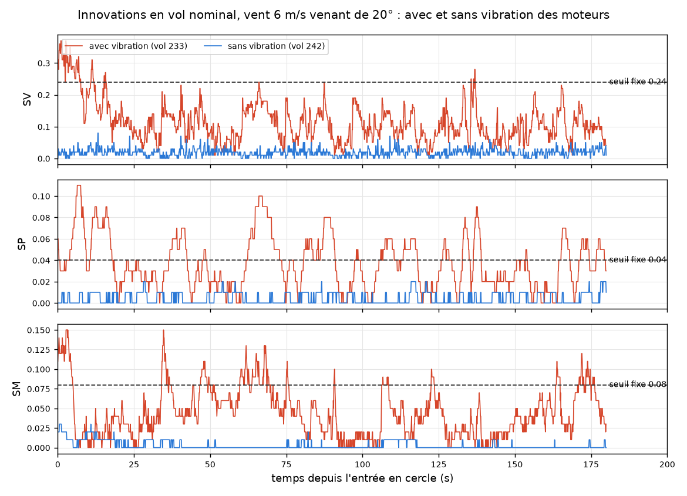

**Détecteurs** (2 258 s de nominal : 1 372 s avec vibration, 886 s sans) :

| Détecteur | Fausses alarmes avec vibration | Sans vibration | Biais de 0,3 m/s², avec vibration (×3) | Sans vibration (×3) |
|---|---|---|---|---|
| Seuil fixe | **155** | 0 | alarme déjà active à l'injection | 3,1 à 11,6 s |
| Seuil adaptatif | 1 (vol 234) | 0 | **manqués tous les trois** | 1,7 à 2,1 s |
| Isolation Forest (et combinaison) | **37** | 0 | alarme déjà active à l'injection | 2,7 à 3,2 s |

Le seuil adaptatif suit le niveau relevé des innovations et ne fait presque pas de fausse alarme,
mais le biais de 0,3 m/s² se perd dans la vibration. Les deux autres détecteurs sont en alarme
avant même l'injection : leurs « détections » ne prouvent rien. Aucun des détecteurs actuels ne
convient tel quel à un drone qui vibre ; il faudrait au moins les recalibrer sur des nominaux avec
vibration.

**Navigation à l'estime** (coupure GPS de 60 s avec traînée, erreur vraie en mètres, un vol par
vent) :

| Vibration | +10 s | +30 s | +60 s | Maximum pendant la coupure | Temps dans la zone pendant la coupure |
|---|---|---|---|---|---|
| Sans (vols 229 à 231) | 1 à 2 | 3 à 12 | 6 à 45 | 8 à 47 | 90 à 100 % |
| Avec (vols 234, 237, 240) | 7 à 18 | 48 à 104 | 81 à 112 | 107 à 160 | 44 à 58 % |
| Avec, vol pilote 232 | 17 | 124 | 61 | 186 | 25 % |

Avec vibration, ArduPilot signale « EKF variance: position lost » et bascule sur le deuxième cœur
environ 41 s après la coupure, mais aucun cœur n'arrête de naviguer. Le deuxième cœur a moins
dérivé : l'erreur de l'estimée sur laquelle pilote le drone retombe alors (décrochage de la
figure), et son maximum est atteint juste avant la bascule. La vibration de
l'accéléromètre, que l'EKF intègre deux fois pour obtenir la position, est la cause probable de
cette dérive (non vérifié). Elle est du même ordre que celle du bruit blanc de gyroscope le plus
fort (145 à 211 m à +60 s au bruit 60), alors que cette vibration est jugée acceptable.

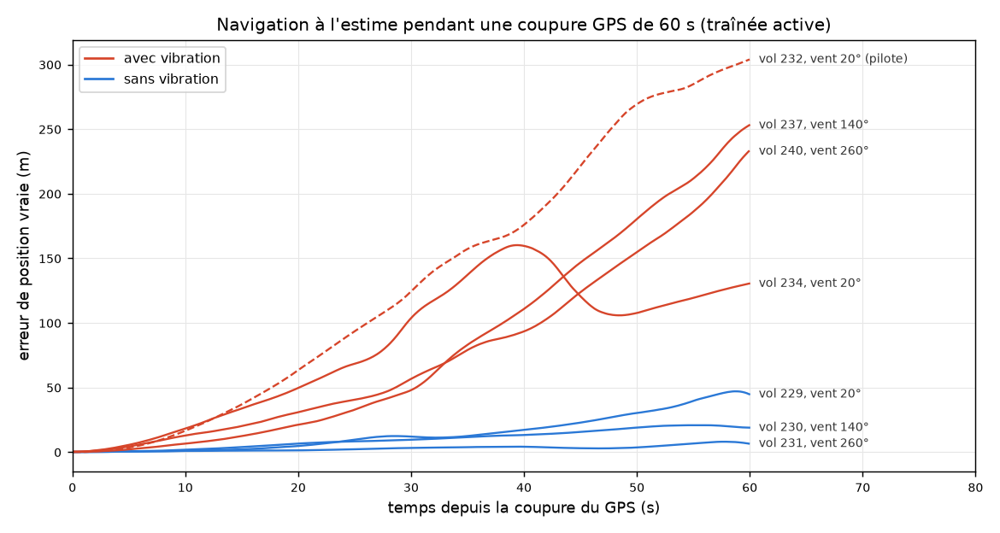

**R3 v3 avec vibration** (un vol par case ; distance au centre et fin du vol mesurées sur la position
vraie du simulateur) :

| Vol | Panne, vent | Exclusion du GPS | Suite | Pendant la panne : erreur à la fin, distance max au centre, temps dans la zone | Fin du vol (distance au départ) |
|---|---|---|---|---|---|
| 248 | leurre, 20° | +0,7 s (SP en premier) | GPS repris 30 s après le retrait (écart 43,5 m, tolérance 78,8 m) | 15 m, 56 m, 100 % | posé à 5 m |
| 250 | leurre, 140° | +0,7 s (SP en premier) | dernier recours : RTL refusé faute de position, LAND | 319 m, 292 m, 46 % | posé à 341 m |
| 252 | leurre, 260° | +0,6 s (SP en premier) | dernier recours RTL | 153 m, 129 m, 59 % | posé à 157 m |
| 249 | brouillage, 20° | +0,6 s (fix perdu) | dernier recours RTL | 114 m, 143 m, 36 % | **coupé en l'air à 134 m de haut, à 2 030 m** (*) |
| 251 | brouillage, 140° | +0,7 s (fix perdu) | dernier recours RTL | 116 m, 114 m, 68 % | coupé en l'air à 15 m de haut, à 114 m (après être passé à 2,1 km, 18 min de vol) (*) |
| 253 | brouillage, 260° | +0,7 s (fix perdu) | dernier recours RTL | 231 m, 231 m, 52 % | **coupé en l'air à 19 m de haut, à 2 437 m** (*) |

L'exclusion reste correcte dans les six vols. Mais R3 ne reprend le GPS sain qu'une fois sur six
(contre six sur sept sans vibration) : la dérive à l'estime dépasse vite sa tolérance de retour.
Le dernier recours devient alors dangereux : le RTL vise le départ avec une position estimée fausse
de plusieurs centaines de mètres (ArduPilot coupe aussi le SmartRTL, « bad position »), et deux
drones finissent à plus de 2 km.

(*) **Défaut du banc de test, corrigé depuis** : `vol_auto.py` jugeait le drone posé dès que
l'altitude *estimée* passait une fois sous 0,3 m, puis forçait le désarmement 20 s plus tard sans
revérifier. Sous vibration, l'altitude estimée peut dériver après le contact avec le sol et le
drone redécoller : ces trois drones ont été coupés en l'air, après le RTL. La phase de mission,
seule mesurée, n'est pas concernée. Le désarmement forcé exige maintenant 15 s posé d'après l'état
vrai du simulateur (message `SIM_STATE`).

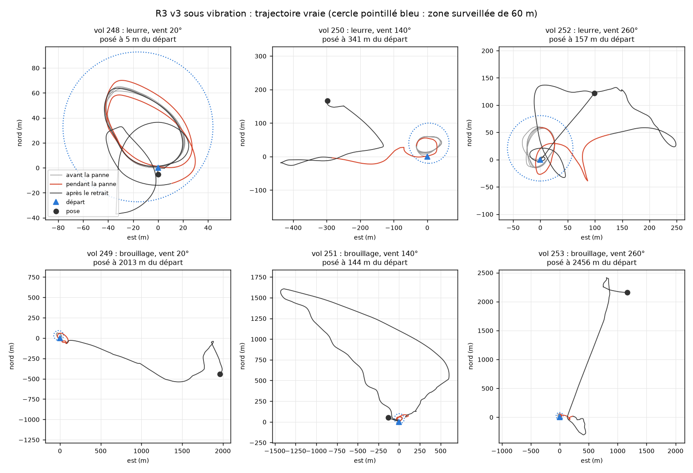

**Piège de mesure** (vérifié dans le code) : quand un cœur EKF arrête de naviguer (« stopped
aiding »), `getPosNE` renvoie la position GPS brute, en la signalant invalide
(`AP_NavEKF3_Outputs.cpp:234-242`), et c'est elle que le log enregistre dans `XKF1`. L'erreur de
navigation calculée par `erreur_navigation.py` compare alors le GPS à la vérité, plus l'estimée : ses
valeurs ne valent rien après ce message (vol 250 après 204 s de cercle, vol 252 après 285 s). Les
erreurs pendant la panne du tableau ci-dessus sont antérieures à ces messages. Le pilote, lui,
respecte l'invalidité et garde la dernière position valide (`AP_AHRS.h:278`,
`AP_InertialNav.cpp:18-21`). Pourquoi le drone du vol 250 revient alors vers le cercle n'est pas
expliqué. `erreur_navigation.py` compte désormais l'estimée comme invalide après ce message.

**Correction de méthode (2026-10-22)** : jusqu'ici, `erreur_navigation.py` mesurait toujours
l'estimée du cœur EKF 0, alors que le drone pilote sur le cœur principal, qui peut changer en vol
(« EKF3 primary changed »). Sans vibration, les deux cœurs restent proches ; sous vibration, ils
divergent. Le script suit maintenant le cœur principal (`--coeur0` redonne l'ancien calcul), et
les chiffres de ce document ont été recalculés : sur les vols 129 à 269, l'erreur change de plus de
1 m sur 26 vols sur 141, surtout sous vibration (coupures GPS : 131 à 304 m à +60 s avec le
cœur 0, 61 à 112 m avec le cœur principal ; vol 248 : 113 m contre 15 m), parfois à la hausse
(R3 v2, vol 159 : 82 m contre 152 m après la panne). Les conclusions qualitatives ne changent pas.

Limites : un vol par case, un seul vent et un seul niveau de vibration ; le modèle de vibration du
simulateur (une sinusoïde par moteur) n'a pas été comparé à des logs de vrais drones, et une
erreur de 107 à 186 m en 60 s pour une vibration jugée acceptable reste à confirmer (un effet
propre au simulateur n'est pas exclu).

## Flux optique : naviguer sans GPS sous vibration (vols 254 à 267)

Sous vibration, l'erreur de la navigation à l'estime atteint 107 à 186 m en 60 s, et R3 ne reprend presque
jamais le GPS. Un capteur de flux optique (caméra orientée vers le sol) associé à un télémètre
mesure la vitesse par rapport au sol : il borne cette dérive sans dépendre du GPS.

**Réglages** (`lancer_vol.sh --flux_optique`, fichier `scripts/flux_optique.parm` chargé au
démarrage par `sim_vehicle.py --add-param-file`, car `FLOW_TYPE` et `RNGFND1_TYPE` ne sont lus
qu'au démarrage) : flux simulé (`SIM_FLOW_ENABLE 1`, `FLOW_TYPE 10`, bruit `SIM_FLOW_RND` laissé à
0,05 rad/s) et télémètre analogique repris du test `OpticalFlow` d'ArduPilot. Deux réglages
désactivent le suivi du terrain, actif par défaut dès qu'un télémètre existe : `SURFTRAK_MODE 0`
et `WP_RFND_USE 0` (sinon la consigne d'altitude passe de 15 à 15,5-16,7 m, vols pilotes 254 à
256). `vol_auto.py --flux_permanent` fait fusionner le flux en permanence, même quand le GPS est
utilisé (`EK3_SRC3_VELXY 5` et `EK3_SRC_OPTIONS 1`, « fuse all velocities ») : quand R3 bascule sur
le jeu de sources sans GPS, le flux est déjà en place. Dans ce jeu, la vitesse GPS n'est plus
fusionnée, car l'EKF ne la fusionne que si la source de position est le GPS
(`AP_NavEKF3_PosVelFusion.cpp:562-565`).

**Vols pilotes** (vent 6 m/s venant de 20°, turbulence 2) : la vitesse mesurée par le flux suit
celle du GPS (corrélation 0,95 sans vibration et 0,96 avec, vols 254 et 255, flux non fusionné).
Coupure GPS de 60 s avec traînée et vibration (vol 257, flux fusionné en permanence) : erreur de
position vraie de 1 / 4 / 9 m à +10 / 30 / 60 s, contre 18 / 104 / 81 m sans flux (vol 234), et
100 % du temps dans la zone. Prix à payer : en nominal sous le même vent, le maximum de
l'innovation de vitesse SV passe de 0,31 sans flux (vol 233) à 0,51 et 0,39 avec flux (vols 256 et
258), SP et SM restant du même ordre : le nominal s'écarte encore plus de celui sur lequel les
détecteurs ont été calibrés.

**R3 v3 avec flux optique et vibration** (vols 259 à 267, mêmes vents et mêmes instants
d'injection que les vols 248 à 253 ; R3 inchangé) :

| | Sans flux (vols 248 à 253) | Avec flux (vols 259 à 267) |
|---|---|---|
| Pannes | leurre de 100 m en échelon, brouillage | leurre en échelon, leurre en rampe jusqu'à 100 m, brouillage |
| GPS écarté correctement | 6 / 6 | 9 / 9 (+0,5 à +0,7 s) |
| GPS sain repris | 1 / 6 | **9 / 9**, 30 s après le retrait (écart 4 à 17 m, tolérance 78,8 m) |
| Erreur de position à la fin de la panne | 15 à 319 m | **4 à 15 m** (maximum 6 à 15 m) |
| Temps dans la zone pendant la panne | 36 à 100 % | **100 %** |
| Dernier recours | 5 / 6 | 0 / 9 |

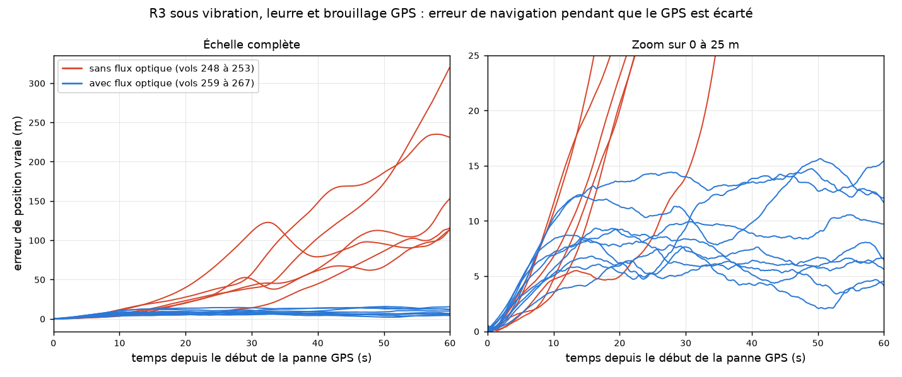

Pendant les dix premières secondes, les erreurs sont les mêmes avec et sans flux ; ensuite,
l'erreur reste bornée à quelques mètres avec le flux. Le leurre en rampe est écarté aussi vite
que le leurre en échelon, comme sans flux (R3 v3) : le leurre décale la position GPS mais pas la
vitesse GPS, et l'EKF voit l'incohérence tout de suite. Le flux n'améliore pas la détection, il
rend la suite (tenir la mission, puis revenir au GPS) possible.

Un défaut reste : au vol 267 (brouillage, vent 260°), R3 écarte une seconde fois le GPS, à tort,
38 s après l'avoir repris (innovations de vitesse et de position en hausse juste avant, cause non
établie), et le retour se fait sans GPS. C'est aussi pendant cet atterrissage que le défaut du
banc de test décrit plus haut a été trouvé (drone coupé en l'air à 33 m) ; les vols 264 et 265 ont
aussi été coupés en l'air, à 2,5 et 7 m, toujours après le RTL.

Limites : un vol par case, un seul vent et un seul niveau de vibration ; le flux simulé voit un
sol plat et texturé partout, à 15 m de hauteur, de jour, sans eau ni herbe qui bouge ; le bruit
du flux est celui par défaut du simulateur, non comparé à un vrai capteur.

## Autoencodeur sous vibration et flux optique (vols 273 à 328)

Les détecteurs précédents ont été calibrés sans vibration. Pour les recalibrer et tester un
autoencodeur dans les mêmes conditions, une campagne de 56 vols a été faite avec vibration et flux
optique fusionné en permanence, sans réponse aux pannes (la signature complète de chaque panne est
enregistrée) : 24 nominaux, du vent nul à 9 m/s, et 32 pannes, quatre vols par type sous des vents
de 3, 6, 6 et 9 m/s. Le rôle de chaque nominal a été fixé avant la campagne
(`docs/roles_campagne_nuit.csv`) : 14 pour l'apprentissage, 4 pour la validation, 6 pour le test.
Le vol 328, un nominal d'apprentissage, s'est écrasé au décollage (alignement du cap de l'EKF raté
sous vibration et vent) : il reste 13 vols d'apprentissage. Six vols finissent sans désarmement :
au sol, le drone rebondit et redécolle (jusqu'à 19 m) et le banc de test refuse de couper les
moteurs tant qu'il n'est pas posé ; leur mission est complète.

**Autoencodeur** (`scripts/detecteur_ae.py`) : un réseau de neurones (scikit-learn, couches
120 → 32 → 8 → 32 → 120) apprend à recopier les 3 dernières secondes des quatre innovations SV, SP,
SH et SM, chacune divisée par son écart-type nominal, en passant par un goulot de 8 neurones. Le
score est l'erreur de reconstruction : faible sur ce qui ressemble au nominal appris, d'autant
plus grande que la fenêtre s'en écarte, sans plafond (contrairement à l'Isolation Forest). Seuil =
plus haut score sur les 4 vols de validation + 10 % (1,56), persistance 0,5 s, même règle GPS que
les autres détecteurs. Tous les réglages ont été fixés avant le test. Les quatre autres détecteurs
gardent leurs règles et sont recalibrés sur les mêmes 13 vols (seuil fixe : SV 1,06, SP 0,36,
SM 0,42, contre 0,24, 0,04 et 0,08 sans vibration).

**Test, une seule exécution** (6 nominaux de test et partie nominale des 32 vols avec panne, soit
4 908 s ; `comparer_detecteurs.py data/jeu_nuit docs/roles_campagne_nuit.csv`) :

| | Seuil fixe | Seuil adaptatif | Isolation Forest | ML + adaptatif | Autoencodeur |
|---|---|---|---|---|---|
| Fausses alarmes | 0 | 13 | 0 | 13 | **0** |
| Pannes détectées | 18 / 32 | 23 / 32 | 10 / 32 | 23 / 32 | **21 / 32** |

| Panne (vols) | Seuil fixe | Seuil adaptatif | Isolation Forest | Autoencodeur |
|---|---|---|---|---|
| Biais d'accéléromètre 0,3 et 0,5 m/s² (3) | 0 | 0 | 0 | 0 |
| Biais d'accéléromètre 1,0 m/s² (1) | 0 | 2,0 s | 4,5 s | 4,1 s |
| Dérive d'accéléromètre jusqu'à 0,3 à 1,0 m/s² (4) | 0 | 0 | 0 | 0 |
| Biais de gyroscope 0,01 rad/s (2) | 0 | 0 | 0 | 0 |
| Biais de gyroscope 0,02 rad/s (2) | 0 | 2, en 5,1 à 7,2 s | 2, en 9,8 à 10,7 s | 0 |
| Magnétomètre (4) | 4, en 0,5 à 0,6 s | 4, en 0,5 à 0,6 s | 2, en 27 à 44 s | 4, en 0,5 à 0,6 s |
| Leurre GPS en échelon, 30 et 100 m (4) | 4, en 0,4 à 0,6 s | 4, en 0,4 à 0,6 s | 0 | 4, en 0,4 à 0,6 s |
| Leurre en rampe jusqu'à 100 m (2) | 2, en 1,5 s | 2 (*) | 1, en 49 s | 2, en 0,5 s |
| Leurre en rampe jusqu'à 30 m (2) | 0 | 2, en 0,6 à 1,5 s | 0 | 2, en 1,7 à 1,8 s |
| Brouillage GPS (4) | 4, en 0,4 à 0,6 s (règle GPS, commune à tous) | 4 | 4 | 4 |
| Accéléromètre de l'IMU 1 bloqué (4) | 4, en 0,8 à 0,9 s | 4, en 0,6 à 0,7 s | 0 | 4, en 0,8 s |

(*) Au vol 282, l'alarme du seuil adaptatif était déjà active au moment de l'injection.
La combinaison « ML + adaptatif » donne les mêmes détections que le seuil adaptatif seul.

Ce qu'il faut en retenir :

- **Sous vibration, aucun détecteur ne voit les petites pannes d'IMU** : biais d'accéléromètre de
  0,3 et 0,5 m/s², dérives (même jusqu'à 1,0 m/s²) et biais de gyroscope de 0,01 rad/s sont
  manqués par les cinq. Sans vibration, ces mêmes types de panne étaient presque tous détectés
  (Isolation Forest : 41 pannes sur 42 au test final). Cause en cours d'analyse.
- L'autoencodeur est le seul à n'avoir aucune fausse alarme tout en détectant plus que le seuil
  fixe (rampe de leurre jusqu'à 30 m, biais de 1,0 m/s²). Le seuil adaptatif détecte deux pannes
  de plus (biais de gyroscope de 0,02 rad/s) mais fait 13 fausses alarmes.
- L'Isolation Forest, pourtant entraîné sur les mêmes vols, ne détecte plus que 10 pannes sur 32
  (cause non cherchée).
- **Le seuil de l'autoencodeur dépend du tirage initial du réseau** : sur 5 graines, 20 ou 21
  pannes détectées, mais un seuil qui varie de 0,68 à 1,59 et 5 fausses alarmes avec l'une
  d'elles. Quatre vols de validation ne suffisent pas à fixer ce seuil de façon fiable. Les
  scores nominaux les plus hauts viennent des vols par vent faible (non expliqué).

Limites : quatre vols par type de panne, un seul niveau de vibration, toujours avec flux optique ;
le modèle n'est valable que dans cette configuration.
