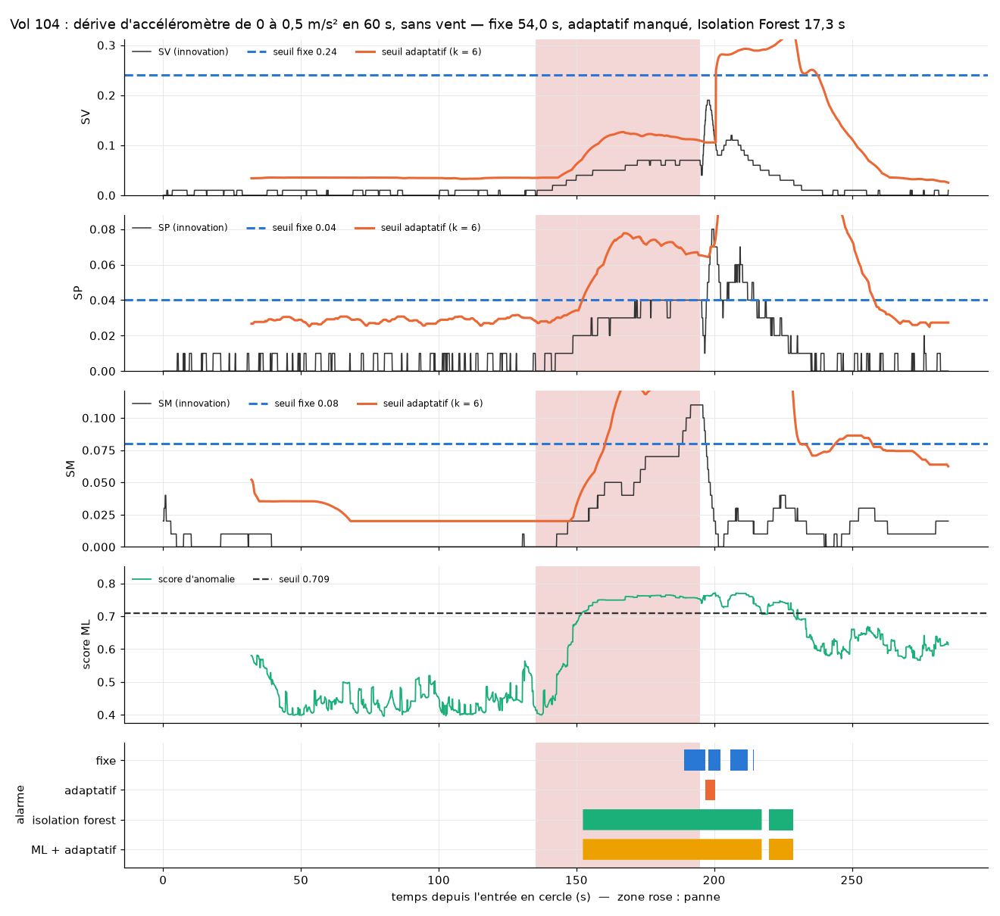
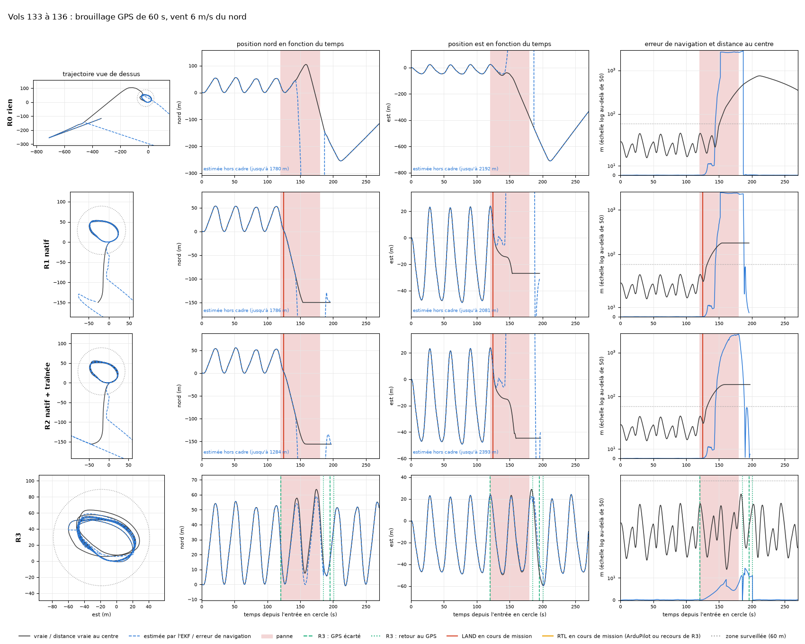
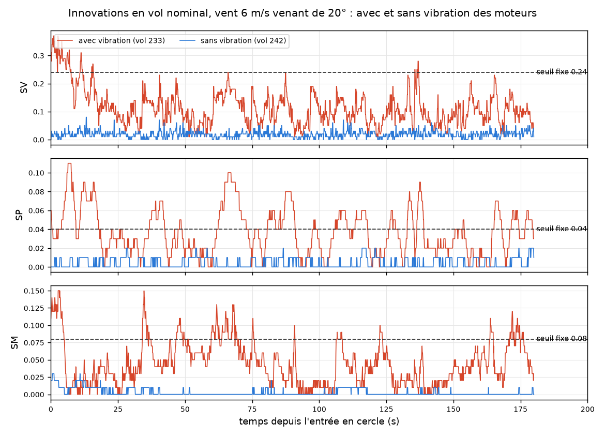
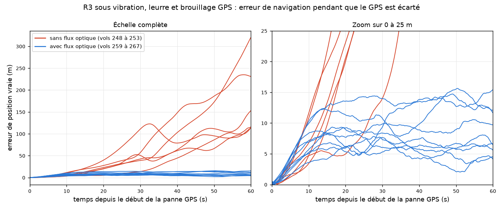

# Résultats détaillés

Les résultats principaux du projet, dans l'ordre où ils ont été obtenus, avec leurs tableaux et
leurs figures. Le [README](../README.md) en donne la synthèse ; [`demarche.md`](demarche.md) donne,
pour chaque étape, le protocole complet, chaque chiffre et les erreurs rencontrées ;
[`vols.md`](vols.md) la liste des vols cités ici par leur numéro.

Noms des réponses aux pannes utilisés dans ce document :

| Nom ici | Nom dans le README | Ce que fait le drone |
|---|---|---|
| R0 « rien » | aucune réaction | rien : le failsafe de l'EKF est désactivé ; sert de référence |
| R1 « natif » | atterrissage d'ArduPilot | la réaction par défaut d'ArduPilot : il atterrit sur place quand l'EKF déclare sa position non fiable |
| R2 « natif + traînée » | atterrissage d'ArduPilot avec traînée | la même, avec le modèle de traînée qui permet de naviguer un temps à l'estime |
| R3 | exclusion du GPS | la réponse GPS de ce projet : écarter le GPS, continuer la mission, le reprendre quand il redevient cohérent |
| R-IMU | vote entre IMU | la réponse IMU de ce projet : désigner l'IMU qui s'écarte des deux autres et forcer le cœur EKF qui ne l'utilise pas |
| boucle | boucle complète | détecteur, puis classifieur, qui choisit seul entre R3, R-IMU et aucune action |

## 1. Avec une IMU idéale, les pannes silencieuses se détectent

Test final sur 60 vols neufs (18 nominaux, 42 pannes, dont quatre types jamais vus pendant les
réglages ; vent de 0 à 9 m/s) :

| | Seuil fixe | Seuil adaptatif | Isolation Forest | Isolation Forest + seuil adaptatif |
|---|---|---|---|---|
| Pannes détectées | 32 / 42 | 31 / 42 | 41 / 42 | **41 / 42** |
| Fausses alarmes (8 217 s de vol normal) | 0 | 0 | 0 | **0** |

La combinaison réagit en 0,5 à 0,7 s aux pannes franches (magnétomètre, accéléromètre bloqué)
et détecte toutes les dérives lentes, que le seuil adaptatif seul manque parce qu'il suit leur
montée (figure 1). Les biais d'accéléromètre de 0,2 à 1,0 m/s² sont vus en 0,7 à 2,6 s.

*Figure 1 — Vol 104 : dérive d'accéléromètre de 0 à 0,5 m/s² en 60 s, sans vent. De haut en
bas : les innovations SV, SP et SM avec le seuil fixe (tirets bleus) et le seuil adaptatif
(orange), le score d'anomalie de l'Isolation Forest et son seuil, puis les périodes d'alarme de
chaque détecteur. Zone rose : panne. Le seuil adaptatif monte avec la dérive et ne la voit
jamais ; l'Isolation Forest la détecte en 17,3 s, le seuil fixe seulement en 54,0 s.*

## 2. Ne pas atterrir : écarter le GPS et continuer la mission

Quatre réponses à une panne GPS ont été comparées sur les mêmes vols :

| Réponse | Ce que fait le drone |
|---|---|
| **R0 « rien »** | aucune réaction : le failsafe de l'EKF est désactivé (`FS_EKF_ACTION 0`). Sert de référence. |
| **R1 « natif »** | la réaction par défaut d'ArduPilot : quand l'EKF signale que sa position n'est plus fiable (failsafe EKF), le drone atterrit sur place. |
| **R2 « natif + traînée »** | la même, avec en plus le modèle de traînée de l'EKF. Ce modèle relie l'inclinaison du drone au vent : l'EKF estime le vent tant que le GPS est là, puis peut continuer à naviguer à l'estime (avec la seule centrale inertielle) quand il disparaît ; ArduPilot rentre alors au point de départ. Le failsafe EKF reste actif : s'il se déclenche, le drone atterrit, comme avec R1. |
| **R3** (ce projet) | écarter le GPS dès que le fix est perdu, ou dès que le détecteur voit l'innovation de position (SP) monter seule alors que le fix est bon (signature d'un leurre) ; continuer le cercle à l'estime ; reprendre le GPS quand sa position reste cohérente avec l'estimée (pendant 5 s dans la première version, 30 s depuis la troisième) ; retour au départ en dernier recours après 2 minutes sans GPS fiable. |

Face à un **brouillage**, sans réponse (R0), l'EKF accepte des positions GPS fausses et l'erreur
de navigation dépasse 2,6 km. ArduPilot (R1 et R2) atterrit sous le vent, hors de la zone
surveillée. R3 écarte le GPS en 0,6 s et garde son cercle, avec une erreur de 9 m (figure 2). Face à un **leurre en échelon**,
R3 écarte le GPS avant que l'EKF ne l'accepte. Sur 30 vols de validation, R3 reprend le GPS sain
6 fois sur 7. Deux défauts restent connus : un leurre en rampe lent peut être repris, et une
dérive d'accéléromètre a été prise une fois pour un leurre.

*Figure 2 — Vols 133 à 136 : brouillage GPS de 60 s sous un vent de 6 m/s venant du nord, une
ligne par réponse (R0 à R3, dans sa première version). Colonnes : trajectoire vue de dessus, positions nord et est au cours
du temps, puis erreur de navigation (bleu) et distance vraie au centre du cercle (noir), en
échelle logarithmique au-delà de 50 m. Trait noir : position vraie ; tirets bleus : position
estimée par l'EKF ; zone rose : panne ; trait rouge : atterrissage déclenché par ArduPilot ;
tirets et pointillés verts : GPS écarté puis repris par R3 ; cercle pointillé : zone surveillée
de 60 m.*

## 3. La vibration des moteurs change tout

Ces premiers résultats ont été obtenus avec une IMU simulée sans bruit ni vibration. Avec la
vibration que les tests d'ArduPilot reprennent d'un quadricoptère de 180 mm (6 à 12 m/s², un
niveau jugé acceptable), les innovations d'un vol normal sont multipliées par 4 à 10 (figure 3). Les
détecteurs calibrés sans vibration font alors jusqu'à 155 fausses alarmes, l'erreur de la
navigation à l'estime atteint 107 à 186 m pendant une coupure GPS de 60 s (au lieu de 8 à 47 m),
et R3 ne reprend le GPS sain qu'une fois sur six.

*Figure 3 — Innovations SV, SP et SM pendant un vol normal sous un vent de 6 m/s venant de 20° :
vol 233 avec vibration (rouge), vol 242 sans vibration (bleu). Tirets : seuils fixes calibrés
sans vibration, franchis à répétition dès que le drone vibre.*

**Un capteur de flux optique** (caméra vers le sol et télémètre, simulés), fusionné en
permanence, borne cette dérive : sous la même vibration, R3 reprend le GPS sain 9 fois sur 9 et
l'erreur de position reste sous 16 m pendant la panne (figure 4).

*Figure 4 — Erreur de position vraie pendant que R3 a écarté le GPS (leurres et brouillages,
vibration, vent de 6 m/s) : sans flux optique (rouge, vols 248 à 253) et avec (bleu, vols 259 à
267). À droite, zoom sur 0 à 25 m.*

## 4. Sous vibration, les petites pannes d'IMU échappent à tous les détecteurs

Les détecteurs ont été recalibrés sur des vols normaux avec vibration et flux optique, un
autoencodeur a été ajouté, puis tous ont été testés une fois sur 32 pannes neuves :

| | Seuil fixe | Seuil adaptatif | Isolation Forest | IF + adaptatif | Autoencodeur |
|---|---|---|---|---|---|
| Pannes détectées | 18 / 32 | 23 / 32 | 10 / 32 | 23 / 32 | **21 / 32** |
| Fausses alarmes (4 908 s) | 0 | 13 | 0 | 13 | **0** |

L'autoencodeur, un réseau de neurones qui apprend à reconstruire le vol normal, est le meilleur
compromis : aucune fausse alarme, et toutes les pannes franches (magnétomètre, leurres GPS,
accéléromètre bloqué) en moins de 2 s. Mais **aucun détecteur ne voit les biais
d'accéléromètre de 0,3 et 0,5 m/s², les dérives, ni le biais de gyroscope de 0,01 rad/s**, alors
que ces pannes étaient presque toutes détectées sans vibration. Le seuil de l'autoencodeur dépend
aussi du tirage initial du réseau (de 0,68 à 1,59 sur 5 graines).

**Pourquoi ces pannes deviennent invisibles** (vols 329 à 340, même biais de 0,3 m/s² et même
vent, en ne faisant vibrer que les gyroscopes ou que les accéléromètres) : chacune des deux
vibrations suffit seule à ajouter à l'innovation de vitesse un bruit plus fort que l'effet de la
panne. Celle des gyroscopes passe surtout par une erreur d'attitude (0,55 à 0,62° contre 0,12 à
0,15° sans vibration), celle des accéléromètres entre directement dans la vitesse prédite. L'EKF
ne s'en protège pas : son mécanisme anti-vibration ne se déclenche pas, son incertitude reste la
même et il s'attribue environ 0,45° d'erreur d'attitude quelle que soit l'erreur vraie. Le flux
optique n'y est pour rien. Deux vols par configuration ; détail dans
[`demarche.md`](demarche.md).

## 5. La famille de la panne se reconnaît 3 s après l'alarme

Un classifieur (forêt aléatoire) reçoit les innovations des 3 s qui suivent l'alarme, leur niveau
des 30 s précédentes et l'état du GPS, et donne la famille de la panne : accéléromètre,
gyroscope, GPS ou magnétomètre. Il est comparé à des règles écrites à la main (GPS si le fix
tombe, magnétomètre si SM domine, accéléromètre sinon). Testé une fois sur 36 vols neufs, sous
des vents jamais vus à l'apprentissage :

| | Pannes détectées | Règles | Forêt aléatoire |
|---|---|---|---|
| Sans vibration (vols 341 à 358) | 18 / 18 | 12 / 18 | **18 / 18** |
| Vibration + flux optique (vols 359 à 376) | 16 / 18 | 7 / 16 | **14 / 16** |

La forêt distingue le gyroscope de l'accéléromètre, ce que les règles ne savent pas faire, et
reconnaît les leurres GPS, qui laissent le fix intact. Ses deux erreurs sont les deux biais
d'accéléromètre de 1,0 m/s² sous vibration, pris pour le gyroscope : à l'apprentissage sous
vibration, cette famille ne comptait presque que des accéléromètres bloqués. Deux vols par type
de panne ; seule la famille est donnée, pas le type ni l'amplitude.

## 6. Une panne sur une seule IMU : la reconnaître par un vote et l'écarter

Le simulateur a été porté à trois IMU. L'EKF d'ArduPilot fait tourner deux cœurs, l'un sur l'IMU 1,
l'autre sur l'IMU 2 ; la troisième sert de témoin. Sur des vols pilotes avec une panne sur l'IMU 1,
**ArduPilot ne bascule jamais sur le cœur sain** : l'erreur d'attitude vraie monte jusqu'à 6°
alors que l'autre cœur reste sous 1° (au test, il a basculé une fois, 9,8 s après l'injection,
une fois l'erreur montée à 5,9°). La réponse R-IMU compare en vol les trois IMU (moyennes sur
2 s), désigne celle qui s'écarte des deux autres, puis force le cœur qui ne l'utilise pas. Ses seuils
ont été fixés sur 12 vols normaux, avant le test.

Testée une fois sur 28 vols neufs, sous trois vents jamais vus, chaque panne volée sans réponse
puis avec R-IMU :

| Erreur d'attitude max, cœur principal | Sans réponse | R-IMU |
|---|---|---|
| Pendant la panne, sans vibration | 1,6 à 5,9° | 0,3 à 1,7° |
| 90 s après la panne, sans vibration | 0,2 à 4,7° | 0,2 à 0,3° |
| Pendant la panne, vibration + flux optique | 3,4 à 6,4° | 1,1 à 3,1° |
| 90 s après la panne, vibration + flux optique | 2,3 à 4,5° | 0,7 à 1,0° |

**La bonne IMU est désignée 12 fois sur 12**, avec le bon capteur (accéléromètre ou gyroscope),
**sans aucune désignation sur les 6 vols normaux**, en 1,1 à 5,4 s pour les biais et en 17 s pour
les dérives lentes. L'erreur qui reste pendant la panne s'accumule avant la bascule. L'erreur de
position, elle, reste sous 1,3 m avec ou sans réponse : le GPS la corrige. Un vol par
configuration ; détail dans [`demarche.md`](demarche.md).

## 7. La boucle complète : l'alarme choisit elle-même la réponse

En vol, la première alarme du détecteur (Isolation Forest ou seuil adaptatif) déclenche le
classifieur. 3 s plus tard, la famille de la panne décide, une seule fois pour tout le vol :
GPS → R3 écarte le GPS ; accéléromètre ou gyroscope → le GPS est gardé, et le vote R-IMU bascule de
lui-même s'il isole une IMU ; magnétomètre → signalé, sans action. Deux règles encadrent la forêt :
la perte du fix écarte le GPS sans attendre, et une famille « GPS » est ignorée si le vote a déjà
désigné une IMU. Un vol pilote a montré que la forêt n'avait jamais vu de leurre : elle a été
réentraînée, avant le test, avec 25 vols anciens de leurre et de brouillage.

Testée une fois sur 48 vols neufs (trois IMU, sans vibration, vent de 6 m/s venant de trois
directions jamais vues), chaque panne volée avec la boucle puis avec la réponse choisie à la main
pour cette panne (R-IMU pour une IMU, R3 sinon) :

| Panne (3 vols chacune) | Boucle | Réponse choisie à la main |
|---|---|---|
| Biais d'accéléromètre, une IMU | IMU désignée en 1,1 s, GPS gardé ; attitude ≤ 0,38° | identique (R-IMU) |
| Biais de gyroscope, une IMU | IMU désignée en 1,5 à 1,6 s ; attitude ≤ 0,27° | identique (R-IMU) |
| Dérive commune aux trois IMU | aucune action | identique (R-IMU) |
| Leurre de 100 m en échelon | GPS écarté à +3,5 s ; erreur de position max 22 à 59 m | R3 : +0,5 s ; 20 à 47 m |
| Leurre en rampe jusqu'à 100 m | GPS écarté à +3,4 s, mais repris à +34 s alors que le leurre dure : 99 m | R3 : même reprise 2 fois, dernier recours 1 fois |
| Brouillage | GPS écarté à la perte du fix (+0,7 s), repris à +90 s 2 fois ; dernier recours 1 fois | identique (R3) |
| Magnétomètre ; vol normal | aucune action | identique (R3) |

**La boucle fait la bonne réponse 24 fois sur 24 sans savoir quelle panne a été injectée**, comme
la réponse choisie à la main, sans exclusion du GPS à tort ni action sur les vols normaux. Le
classifieur donne la bonne famille 12 fois sur 15 ; ses trois erreurs (deux biais d'accéléromètre
pris pour le GPS, une dérive prise pour le gyroscope) n'ont rien changé, rattrapées par le vote ou
sans conséquence. Le prix est un GPS écarté 3 s plus tard sur un leurre, sans effet net sur ces
trois vols. La boucle ne corrige pas les faiblesses de R3 : la rampe lente et, sous le vent de
70°, la navigation à l'estime qui finit en dernier recours (drone non posé, à plusieurs centaines
de mètres). La dérive a été comparée à R-IMU, pas à R3 seul : ce test ne dit pas si la boucle
évite l'exclusion à tort de R3 sur ce cas (vol 206), seulement qu'elle ne la commet pas ici.

**Sous vibration (avec flux optique permanent)**, la boucle est déclenchée par l'autoencodeur OU
l'Isolation Forest OU la perte du fix, et son classifieur a été réentraîné sur des vols avec
vibration. Même test, sur 48 autres vols neufs (vents de 35°, 170° et 310°) :

| Panne (3 vols chacune) | Boucle | Réponse choisie à la main |
|---|---|---|
| Biais d'accéléromètre, une IMU | IMU désignée en 1,1 s ; attitude ≤ 1,3° | identique (R-IMU) |
| Biais de gyroscope, une IMU | IMU désignée en 1,5 à 1,6 s ; attitude ≤ 4,1° | R-IMU : 1,6 à 1,7 s ; ≤ 2,5° |
| Dérive commune aux trois IMU | aucune action | identique (R-IMU) |
| Leurre de 100 m en échelon | GPS écarté à +3,4 s, repris à +90 s ; erreur de position max 4 à 18 m | R3 : +0,5 s ; 7 à 13 m |
| Leurre en rampe jusqu'à 100 m | GPS écarté à +3,5 s, repris à +90 s ; 15 à 19 m | R3 : +0,5 s ; 7 à 21 m |
| Brouillage | GPS écarté à la perte du fix (+0,7 s), repris à +90 s ; 5 à 13 m | identique (R3) ; 6 à 10 m |
| Magnétomètre ; vol normal | aucune action | identique (R3) |

**Bonne réponse 24 fois sur 24 là aussi, sans aucune fausse alarme** sur 3 142 s de vol normal, et
le drone reste 100 % du temps dans la zone surveillée, de l'injection à 150 s après. Le
classifieur donne la bonne famille sur les 9 vols qu'il classe (leurres, rampes, magnétomètre).
Chaque alarme a été attribuée à son détecteur : toutes viennent de l'autoencodeur ; l'Isolation Forest n'a sonné que par la règle du
fix, pendant les brouillages. Sous vibration et avec le flux optique, la rampe ne fait plus
reprendre le GPS trop tôt (cause non vérifiée). Les petites pannes d'IMU restent invisibles aux
détecteurs : ici, le vote traite seul celles d'une seule IMU.
